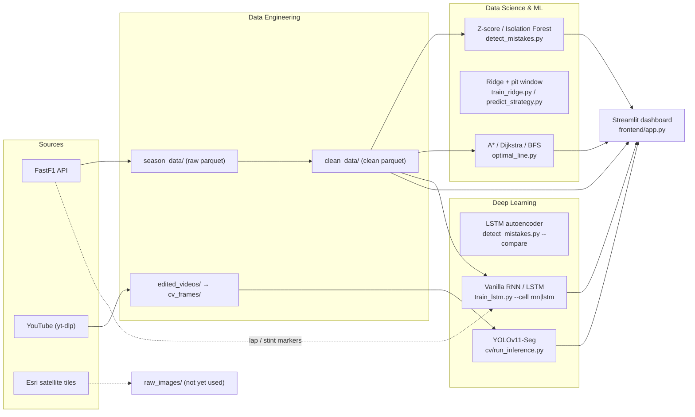

# ApexHunter 2.0 — Project Documentation

**Project Title:** ApexHunter 2.0 — F1 Telemetry & Onboard-Video Analytics Platform
**Courses:** Data Science & Machine Learning · Deep Learning
**Academic Year:** 2026–2027

| Enrolment Number | Student Name |
|---|---|
| 23001091 | Parin Shah |

> **Project history.** The first version of ApexHunter 2.0 was built in the previous semester
> (Jan–May 2026) for the *Artificial Intelligence* and *Big Data* courses. This semester the same
> codebase is being continued for *Data Science & Machine Learning* and *Deep Learning*. This
> document describes the project **as it currently exists in the code**. Section 8 lists every
> known limitation and is updated whenever the code changes.

---

## Table of Contents

1. [Overview](#1-overview)
2. [System Architecture](#2-system-architecture)
3. [Datasets](#3-datasets)
4. [Data Engineering Pipeline](#4-data-engineering-pipeline)
5. [Data Science & Machine Learning](#5-data-science--machine-learning)
6. [Deep Learning](#6-deep-learning)
7. [Dashboard](#7-dashboard)
8. [Current Status & Known Limitations](#8-current-status--known-limitations)
9. [Testing](#9-testing)
10. [How to Run](#10-how-to-run)

---

# 1. Overview

ApexHunter 2.0 analyses Formula 1 driving performance from two kinds of data:

- **Structured telemetry** for every driver in every qualifying and race session of the 2023 and
  2024 seasons (~57.9 million rows), fetched via the FastF1 library.
- **Unstructured onboard video** of the pole-position lap of every 2023 and 2024 Grand Prix
  (46 videos).

The telemetry and video feed four analytical components, and an interactive Streamlit dashboard
presents the results:

| Component | Technique | Course | Question it answers |
|---|---|---|---|
| Driver mistake detection | Z-score vs Isolation Forest (unsupervised anomaly detection) vs LSTM autoencoder, on deviations from the field at the same track position | DSML / Deep Learning | Where in a session did the driver drive differently from the fastest other drivers? |
| Racing-line search | A\*, Dijkstra, BFS on a telemetry-weighted grid | DSML (optimisation / search) | What is the lowest-cost path through the driver's own telemetry footprint? |
| Tyre pace + pit window | Ridge vs vanilla RNN vs LSTM predicting the next lap time; pit window from wear + measured pit cost | DSML / Deep Learning | When should the driver change tyres, and should he pit under a safety car? |
| Apex detection | YOLOv11-Seg instance segmentation (transfer learning) | Deep Learning | How close does the car come to the apex curb at each corner? |

**This semester** (see [ROADMAP.md](ROADMAP.md)): each problem is a simple baseline → machine
learning → deep learning comparison, all built (Nov 2026). Mistake detection: Z-score vs the
reworked Isolation Forest vs an LSTM autoencoder. Tyre/pace prediction: Ridge regression vs a
vanilla RNN vs an LSTM, feeding a pit-window check against the real stops.

The project also includes supporting data infrastructure from the previous semester: a pandas ETL
pipeline, an equivalent Apache Spark job, HDFS storage, and a MongoDB document store.

---

# 2. System Architecture



### Repository layout

```text
backend/
  config.json                 seasons, frame-extraction, inference thresholds, circuits, video URLs
  scripts/
    utils.py                  shared paths, config loader, logger, IST timezone
    detect_mistakes.py        Isolation Forest orchestrator
    train_lstm.py             LSTM training orchestrator
    predict_strategy.py       pit-window output for one driver (Ridge / RNN / LSTM / rule-based wear)
    check_strategy.py         pit-window check of every wear source on the test races
    optimal_line.py           racing-line orchestrator
    etl/                      download_season_data, clean_telemetry, fix_parquet_timestamps,
                              download_manual_videos, download_satellite_images
    bigdata/                  hdfs_manager, spark_clean_telemetry, mongo_manager
    cv/                       extract_frames, select_training_frames, extract_turns,
                              run_inference, inference_geometry/masking/hud/io
    isolation_forest/         mistakes_features, mistakes_model, mistakes_eval, mistakes_events, mistakes_timeloss, mistakes_io, mistakes_autoencoder
    lstm/                     tyre_data, tyre_model (TyrePaceRNN), tyre_io, tyre_ridge
    strategy/                 pit_cost, pit_window, strategy_check, strategy_output
    racing_line/              racing_line_grid, racing_line_search, racing_line_io
    tests/                    unit/ (31 files), integration/ (9 files), run_tests.py
frontend/
  app.py, config.py
  components/                 sidebar, data_loader, header_bar, telemetry_charts, track_map,
                              cv_feed, ai_analysis, racing_line, bigdata_tab, bigdata_charts, scrubber
models/                       best.pt (YOLO); tyre_lstm.pt + tyre_scaler.pkl + tyre_config.json (LSTM);
                              tyre_rnn.pt + _scaler.pkl + _config.json (RNN); tyre_ridge.pkl + _config.json
data_lake/                    all data and model outputs (gitignored)
docs/                         this document, ROADMAP.md, ISOLATION_FOREST_REWORK.md;
                              LAST_SEM/ (previous-semester files), ARCHIVE/ (merged docs)
```

---

# 3. Datasets

## 3.1 Structured — FastF1 telemetry

| Property | Value |
|---|---|
| Source | Official F1 timing data via the `fastf1` Python library (v3.8) |
| Coverage | 2023 (22 rounds) and 2024 (24 rounds); Qualifying (Q) and Race (R) for each → 92 sessions |
| Rows | 57,874,119 |
| Size | 1,718 MB raw / 1,691 MB clean (snappy-compressed Parquet) |
| Granularity | One row per merged car-data/position sample; median interval ≈ 0.13 s (~7.7 Hz) |
| Typical size | ~420k rows per qualifying session, ~800k rows per race (20 drivers) |
| File naming | `{year}_{round}_{Q|R}.parquet`, e.g. `2023_1_Q.parquet` |

**Schema (clean data):**

| Column | Type | Meaning |
|---|---|---|
| `Date` | datetime | Absolute timestamp of the sample |
| `SessionTime` | timedelta | Time since session start, the main time axis |
| `Speed` | float32 | km/h |
| `RPM` | float32 | Engine revolutions per minute |
| `nGear` | int | Gear 0–8 |
| `Throttle` | float32 | Throttle pedal, 0–100 % |
| `Brake` | float32 | **Binary brake flag (0 = off, 1 = on).** FastF1 provides brake as a boolean, not a pressure. |
| `X`, `Y`, `Z` | float | Car position in FastF1 track coordinates |
| `Driver` | string | Car number as a string (e.g. `"1"` = Verstappen, `"44"` = Hamilton) |
| `Round`, `Session`, `Year` | int/str | Session identifiers |
| `Time` | timedelta | Synthesised by the cleaning step from the row index (see §8) |

## 3.2 Unstructured — onboard pole-lap video

| Property | Value |
|---|---|
| Source | YouTube, downloaded with `yt-dlp` (a few manually specified URLs in `config.json`) |
| Content | Onboard pole-position qualifying lap for each 2023 and 2024 round |
| Count / size | 46 videos; 2.3 GB downloaded, 1.8 GB after manual trimming to the lap |
| Format | MP4, ≤1080p |
| Extracted frames | 21,282 JPEGs at 5 fps (6.7 GB) |
| Annotated set | 506 frames selected (11 per video), labelled in Roboflow with two classes: `curb`, `road` |
| Exported dataset | 1,281 training images (after Roboflow augmentation) and 226 validation images |

## 3.3 Satellite imagery

24 circuit images (1280×1280 PNG, 76 MB) downloaded from Esri World Imagery with `staticmap`.
They are stored in `data_lake/raw_images/satellite_maps/` but the dashboard does not use them yet.

## 3.4 Data quality

| Issue | Observation | Handling |
|---|---|---|
| Missing values | Occasional NaN sensor packets | Rows with Speed, RPM, X and Y all missing are dropped; other gaps are forward-filled. In practice no rows were dropped (57,874,119 in = out). |
| Outliers | Throttle values up to 104 % appear in raw data | Clipping: Speed 0–380, RPM 0–15,000, Throttle 0–100, Brake 0–1 |
| Binary brake | `Brake` carries no pressure information | Treated as an on/off flag everywhere: compared with the field's brake-on share for the Isolation Forest, a fraction of braking samples per cell for the racing line, and fraction of the lap spent braking for the LSTM |
| GPS noise | X/Y jitter, especially at low speed | Not filtered |
| Imbalance | Races have ~2× the rows of qualifying sessions; DNFs truncate data | Models process each session independently |
| Selection bias | Onboard videos exist only for the pole sitter, which favours front-running teams | Acknowledged; CV results are per-lap case studies |

---

# 4. Data Engineering Pipeline

## 4.1 Extract — `etl/download_season_data.py`

For each configured season it reads the event schedule (the years in `config.json` are strings and
are converted to integers for FastF1); the highest round number is the season length. If the
schedule cannot be fetched, that season is skipped and reported rather than guessed. For each
round and each session type
(`Q`, `R`) it then loads the session with `fastf1` (`telemetry=True, laps=True, weather=False`) and
calls `laps.pick_drivers(d).get_telemetry()` for every driver. It keeps the 14 columns listed in §3.1
(without `Time`) and writes `data_lake/season_data/{year}_{round}_{type}.parquet`. Sessions whose
file already exists are skipped. API responses are cached in `cache/`. At the end the script
logs a count per outcome (saved, skipped, empty, partial, failed), lists any failed or partial
sessions, and exits with code 1 if there were any. A *partial* file (some drivers failed to load)
is still saved; delete it and re-run to retry those drivers.

Videos are downloaded with yt-dlp into `downloaded_videos/{year}/` by
`etl/download_manual_videos.py`, one batch at a time (`manual_downloads` in `config.json` holds a
year and name → URL pairs; the config keeps the last batch), and trimmed by hand into
`edited_videos/`. Satellite images come from `etl/download_satellite_images.py`.

## 4.2 Transform — `etl/clean_telemetry.py` (pandas)

| Step | Operation |
|---|---|
| 1 | Add any missing expected column (`Driver`→`"UNKNOWN"`, `Time`/`SessionTime`→index seconds, `nGear`→8, numerics→0) |
| 2 | Drop rows where Speed, RPM, X and Y are **all** NaN |
| 3 | Forward-fill all numeric columns |
| 4 | Clip Speed 0–380, RPM 0–15,000, Throttle 0–100, Brake 0–1 (binary flag) |
| 5 | Downcast Speed, RPM, Throttle, Brake, X, Y to `float32` |
| 6 | Write snappy Parquet to `data_lake/clean_data/` (via a temporary file renamed on completion; skips files that already exist) |

## 4.3 Spark equivalent — `bigdata/spark_clean_telemetry.py`

The same transformation written in PySpark 3.5.1 (`local[*]`, 4 GB driver memory). It reads either
local `season_data/` (as a `file:///` URI, because an installed Hadoop makes HDFS the default file
system) or `hdfs://localhost:9000/apexhunter/season_data`. Forward-fill uses
`last(..., ignorenulls=True)` over a window partitioned by year, round, session and driver and
ordered by `SessionTime`. Output is Parquet partitioned by `Year/Round/Session`, written to its own
folder, `clean_data_spark` (local `data_lake/clean_data_spark/` or `/apexhunter/clean_data_spark`),
never into the pandas `clean_data` folder. The last recorded run (HDFS mode, May 2026, before these
fixes) processed 57,874,119 rows in 78 s and wrote 1,740 MB; a local run after the fixes processed
the same 92 files and rows in 99 s. A run log is written to `data_lake/spark_run_log.json`, and a
failed run exits with code 1.
`etl/fix_parquet_timestamps.py` rewrites Parquet timestamps to microsecond precision so that Spark
can read them.

## 4.4 Storage — HDFS and MongoDB

- `bigdata/hdfs_manager.py` wraps `hadoop fs` commands to upload `season_data`, `clean_data` (the
  pandas output) and `mistake_data` to `/apexhunter/...`, verify uploads, and write
  `data_lake/hdfs_status.json`. The status lists files recursively and also covers Spark's
  `/apexhunter/clean_data_spark`; folders and Hadoop marker files (`_SUCCESS`, `.crc`) are not
  counted as files. The stored status (May 2026) predates this and still shows Spark's output in
  `clean_data` as three "files" (`Year=2023`, `Year=2024`, `_SUCCESS`) until HDFS is re-run.
- `bigdata/mongo_manager.py` (database `apexhunter` on `localhost:27017`) upserts:
  - `mistake_annotations`: one document per session × driver (session keyed by file name, e.g.
    `2023_1_R.parquet`), containing the Isolation Forest metadata plus summary statistics
    (mean/std anomaly score, mistake rate, speeds).
  - `telemetry_sessions`: one metadata document per session file (92 documents).

  It also provides query helpers (leaderboard, per-driver history) and writes
  `data_lake/mongo_status.json`. One MongoDB client is shared per process.

These systems are optional at runtime. The dashboard reads their JSON status files and falls back
gracefully when HDFS or MongoDB are offline; it checks whether MongoDB is reachable at most once a
minute, so an offline MongoDB does not slow down every interaction.

---

# 5. Data Science & Machine Learning

## 5.1 Exploratory data analysis

EDA lives in the dashboard (Telemetry and Big Data tabs):

- Five-panel time series of Speed, Throttle, Brake, Gear and RPM with a time scrubber.
- Speed-coloured track map built from X/Y coordinates.
- Speed distribution histograms for the five drivers with the most samples.
- Pearson correlation heatmap of Speed, RPM, Throttle, Brake, X, Y, Z and nGear.
- Speed vs RPM scatter coloured by gear, which shows the gear-ratio bands.
- Brake/throttle overlap percentage for the selected driver (share of samples at ≥ 50 km/h with
  the brake on and throttle > 5 %; slower samples are excluded because in the garage, pit box or
  on the grid both pedals are often held on purpose).

## 5.2 Driver mistake detection — Isolation Forest (vs Z-score baseline)

**Full write-up (method, evaluation, results, outputs, tests, decisions, history):
[ISOLATION_FOREST_REWORK.md](ISOLATION_FOREST_REWORK.md).** Summary:

- **Question asked of every sample:** is the driver doing something unusual compared with what the
  5 fastest other drivers do at the same point on track? Representative laps only; each sample is
  projected onto the session's fastest lap; 5 features = deviations from the field's median per
  10 m (speed, throttle, brake-on share, gear, acceleration), scaled by the field's spread and
  smoothed over 0.5 s. In races, samples with DRS open or < 1 s behind another car are left out
  (DRS and the gap come from FastF1's telemetry).
- **Model:** Isolation Forest (200 trees, all rows per tree) on the driver's own laps; the 2 %
  most anomalous samples are flagged; flag runs (flags < 1 s apart) of at least 0.5 s become **events** with a corner
  location ("Approaching Turn 14"), a plain-language reason and the **time lost** vs the driver's
  own nearby laps (32–40 events per race, ranked by time lost; likely lift-and-coast / tyre
  saving is labelled and ranked last).
- **Evaluation:** (1) fake mistakes planted in held-out laps (lock-up, early lift, late throttle,
  pedal overlap, missed downshift), scored per mistake: precision 0.43–0.55, recall 0.23–0.31,
  F1 0.32–0.38 on 4 sessions; (2) real-data check: in both Bahrain races 15–19 % of events cost
  clear time vs 10–12 % of random spots (not at Monaco).
- **Z-score baseline and LSTM autoencoder** (`--compare`) on the same features, planted mistakes
  and flag rate: three detectors in one table (ISOLATION_FOREST_REWORK.md §5, §5b). The autoencoder
  (~2 s windows rebuilt by an encoder/decoder LSTM) finds the most planted mistakes; the Isolation
  Forest is best on missed downshifts, the Z-score rule on precision.
- **Limitation:** only ~1 in 4 planted mistakes is found, and some events are different from the
  field without costing time (driving style, a different line).

```bash
python backend/scripts/detect_mistakes.py --session data_lake/clean_data/2023_1_R.parquet --driver 1 [--force] [--compare]
```

## 5.3 Racing-line search — A\*, Dijkstra, BFS

**Files:** `optimal_line.py`, `racing_line/racing_line_grid.py`, `racing_line_search.py`, `racing_line_io.py`

This component uses classical search and optimisation rather than learning. It sits with DSML as
the optimisation part of the pipeline.

### Graph construction
- The driver's X/Y samples for the **whole session** are binned into square cells (default 50 track
  units). Each occupied cell becomes a node holding its mean speed, mean brake and sample count.
- Node cost = `max(0.01, 1 − mean_speed/380 + 2 · brake_fraction)`, where `brake_fraction` is the
  share of the cell's samples with the brake on (0–1). Faster cells are cheaper; cells where the
  driver is usually braking are more expensive.
- 8-connected grid. Edge cost = average of the two node costs × (1 for orthogonal, √2 for diagonal moves).
- Distances are converted to metres with FastF1's documented position unit: X/Y are in 1/10 m,
  so the scale is a constant 0.1 m per unit for every circuit. We checked this by integrating
  speed over fastest laps at Bahrain, Monaco, Silverstone and Spa (0.0996–0.1006 m/unit).

### Search
- The driver's fastest lap is taken from FastF1 (`laps.pick_drivers(driver).pick_fastest()`) and
  the telemetry is sliced to that lap's start and end times. If FastF1 has no valid fastest lap
  for the driver, the run stops with an error; it never falls back to the whole session.
- The search is split into four legs between five waypoints taken at 0, ¼, ½, ¾ and the end of
  that lap, and the legs are concatenated.
- **A\***: heuristic = Euclidean grid distance × minimum node cost. This never overestimates, so A\*
  is optimal.
- **Dijkstra**: the same search with h = 0. It is the ground-truth check for A\*.
- **BFS**: ignores costs and finds the fewest hops. Its weighted cost is computed afterwards for comparison.

### Time estimate
A path's time is estimated by splitting it into segments and dividing each segment's length by
the speed of the nearest sample of the driver's fastest lap. The driver's own full-resolution lap
is timed the same way, and "time saved" = driver estimate − path estimate (positive = faster).
Because both use the same speeds, the comparison is like-for-like. Applied to the driver's lap,
the estimate is within about 1 % of the real lap time, so smaller differences are noise.

### Outputs
`data_lake/racing_lines/{session}_{driver}_racing_line.json` contains the driver's fastest-lap path
(every 10th sample), the FastF1 lap it came from (`fastest_lap`: lap number, lap time, measured
length in km, and `estimated_time_s`, the time estimate applied to that lap), the scale (`coordinate_scale`, 0.1), and for each algorithm: path, cost, nodes
expanded, compute time, estimated time saved and a found flag. It also holds per-segment deviation
between the A\* path and the driver path.

### Current results — 2023 Bahrain qualifying, driver #1 (Verstappen)
Fastest lap from FastF1: lap 14, 89.708 s (his pole time), 5.34 km of driven path (official
circuit length 5.412 km). Grid: 1,398 cells at resolution 50 (5 m).

| Algorithm | Path cost | Nodes expanded |
|---|---|---|
| A\* | 966.88 | 2,616 |
| Dijkstra | 966.88 | 2,723 |
| BFS (fewest hops) | 990.38 | 2,707 |

- A\* and Dijkstra find the same optimal cost; A\* expands about 4 % fewer nodes. BFS ignores
  cell costs, so its path is 2.4 % more expensive.
- The driver path has 66 points; the A\* path has 991 cells, about 5.34 km long.
- Deviation between the A\* path and the driver's line is 0.4–1.3 m per segment, which is within
  one 5 m grid cell.
- Time estimate check: the driver's lap is estimated at 88.76 s against the real 89.708 s (1 % low).
- Estimated time saved: A\* and Dijkstra −0.08 s, BFS −0.10 s, i.e. about 0.1 % slower than the
  driver and well inside the estimate's ~1 % error. **The search finds no faster line** through
  the driver's own telemetry footprint. This is expected: the graph only contains cells the
  driver already drove, and the node cost (speed and braking) is not a lap-time model, so the
  "optimal" path mostly retraces the driver's line (median 2.4 m from it).

### Usage
```bash
python backend/scripts/optimal_line.py --session data_lake/clean_data/2023_1_Q.parquet --driver 1 [--resolution 50] [--n-corners 16] [--force]
```

---

# 6. Deep Learning

## 6.1 Tyre pace models — Ridge, vanilla RNN and LSTM

**Files:** `train_ridge.py`, `train_lstm.py --cell lstm|rnn`, `predict_strategy.py`, `check_strategy.py`,
`lstm/tyre_data.py`, `tyre_model.py` (`TyrePaceRNN`), `tyre_io.py`, `tyre_ridge.py`, `strategy/`

### Problem
Tyres lose pace as they age; the models predict, from the last 5 laps of a stint, how much slower
the next lap will be, and the pit-window calculation (`strategy/`, ROADMAP §C) turns that into
advice. (Until Nov 2026 the LSTM instead flagged a "tyre cliff"; that output, `predict_cliff.py`,
was removed on 2026-11-04.)

### Data preparation
1. Race sessions are processed in chronological order (by year, then round). For each one, FastF1 lap data (`LapStartTime`, `Time`, `Stint`, `Compound`, `TyreLife`,
   `LapNumber`, `LapTime`) is loaded and joined to the clean telemetry by session time.
2. Each lap is aggregated into 9 features: lap time, mean throttle, mean brake (share of the
   lap spent braking), mean RPM, tyre age (FastF1 `TyreLife`),
   one-hot compound (soft/medium/hard) and race lap number. The three means are weighted by the time
   between telemetry samples, because samples are irregularly spaced (#44).
3. **Only representative laps are used.** Excluded: lap 1 (standing start), out-laps and in-laps
   (pit stops), laps run under safety car, VSC or red flag (FastF1 `TrackStatus` 4/5/6/7), deleted or
   FastF1-generated laps, laps with no lap time, and laps FastF1 marks as inaccurately timed.
   Yellow-flag laps are kept, because yellows are local and barely affect lap pace. On real races
   this removes about 13–16 % of laps; on the 2023 Bahrain and 2024 Miami races, 26–29 % of the
   windows built by the earlier, unfiltered pipeline contained at least one such lap.
   **Only dry tyres:** intermediate and wet laps (2,460 of 44,840 representative race laps in
   2023–24) and laps with no compound or tyre age (35, 2023 Monaco) are left out (#22).
4. Laps are grouped by stint. Stints with fewer than 3 usable laps are discarded.
5. Sliding windows of 5 laps → target = **how many seconds slower (+) or faster (−) the next lap
   is** than the last lap of the window (the tyre wear signal). In each window lap time and the three
   telemetry means are given as differences from the window's last lap, so the model sees how pace
   is changing, not which track it is (#45; absolute values mostly encode the track). Lap time
   replaced mean speed (§C step 1) because the pit strategy adds up lap times. On 2023–24 races
   (28,745 windows, 45 races) the change has mean +0.02 s and spread 0.90 s (98 % within ±2 s);
   predicting "no change" is off by 0.39 s on average (0.357 s on the 5 most recent races, the test set), the bar
   the models must beat.
   Windows are built only within runs of consecutive representative laps, so a window never
   bridges a removed lap (e.g. a safety-car period).
6. **Split by whole sessions, chronologically:** the most recent 10 % of race sessions form the
   test set, and the most recent 20 % of the remaining sessions form the validation set. Splitting
   by session rather than by sequence matters: neighbouring sliding windows share 4 of their 5 laps,
   so a per-sequence split would put near-identical samples on both sides.
7. `StandardScaler` (features) and z-normalisation (target) are fitted on the **training sessions
   only** and then applied to validation and test data, so no test statistics leak into training.

### Architecture

| Component | Value |
|---|---|
| Layers | 2 stacked `nn.LSTM` (or `nn.RNN` with `--cell rnn`) layers, `batch_first=True` (`TyrePaceRNN`) |
| Hidden size | Selected by grid search from {32, 64, 128} |
| Dropout | 0.3 between the recurrent layers; final model trained with 3 seeds |
| Head | Linear(hidden → 1) on the last time step |
| Loss / optimiser | MSE / Adam |
| Batch size | 32 |

### Hyperparameter search
6-configuration grid over hidden size and learning rate
(32/1e-3, 64/1e-3, 128/1e-3, 32/5e-4, 64/5e-4, 128/1e-4). Each configuration is trained for 20 epochs
and scored by best validation MSE. The final model is trained for 50 epochs with the winning
configuration. During every training run the weights from the best-validation epoch are kept and
restored at the end, so the saved model is the one that achieved the reported validation MSE.

### Prediction
- `tyre_model.sequence_predictor` (dropout off) and Ridge's `predict` both give the change in lap
  time; `strategy_check.predicted_changes` keys each prediction by the race lap it predicts.
- Predicted lap time = the previous lap's actual time + the predicted change.
- A lap is predicted only when the 5 laps before it are consecutive representative laps, the same
  rule as the training windows. The first 5 laps of a stint, and the 5 laps after any removed lap
  (e.g. a safety-car period), have no prediction (`null`). The model is therefore never fed padding
  or a window that skips a lap, and no lap is predicted from its own data.
- Every stint with at least 3 representative laps is kept, including stints too short for any
  prediction. Across 8 races (2023–24 R1–R4) 51 of 391 stints (13 %) are like this, e.g.
  Verstappen's first stint in the red-flagged 2023 Australian GP.
- Output: `data_lake/tyre_predictions/{session}_{driver}_strategy.json` (`predict_strategy.py`; see
  "Pit strategy" below).

### Model compatibility
`tyre_config.json` records the feature names the model was trained on. Before loading,
`load_model_artifacts` checks them (and the input size, target and cell) against the current code and
raises a clear "retrain with `train_lstm.py --cell … --force`" error on any mismatch.

### Pit strategy (ROADMAP §C, done 2026-11-03)
The tyre models feed a tyres-only pit-strategy tool (pit window, safety-car stops); the plan and
all results are in [ROADMAP.md](ROADMAP.md) §C. Lap-time target: §6.1 step 5 above.
**Pit cost** (step 2, `strategy/pit_cost.py`): a stop costs the driver's in-lap + out-lap minus the
median of the same two laps for cars that did not pit. Each race uses the median of its own normal
stops (2023–24: 18.5–30 s, overall 22.8 s; races with < 3 such stops use 22.8 s); a stop under SC/VSC
costs 0.7 × that (measured ratio 0.69); red-flag laps get no advice. The pit-lane loss is a track
property teams know before the race, so measuring it from the race's own stops leaks nothing.
**Compounds** (step 3): no compound advice. Fitted on the 40 training races (lap time = base per
driver-race + compound gap + compound wear × tyre age + fuel × lap), soft, medium and hard differ by
only 0–0.2 s when fresh (the sign flips with the lap filter) and all wear 0.04–0.05 s/lap. Race lap
times hide the compounds' real difference (tyre saving, compound chosen to suit the stint, and the
labels map to different C1–C6 rubbers per track). The strategy therefore uses the compound the driver
actually fitted; compound stays a model input.
**Pit window** (step 4, `strategy/pit_window.py`): at every lap, every possible stop lap of the
stint is costed as wear × (old-tyre ages + new-tyre ages up to the end of the following stint) +
pit cost; fuel, track and car are the same for every option and cancel. Wear per lap of tyre age =
mean of all known lap-time changes in the current stint (the whole race so far while the stint has
fewer than 3) + 0.053 s/lap fuel gain, clipped at 0 (fuel gain fitted on the
training races). The window is the best stop lap ±2 (5 laps); laps after the real stop are advised
as if the driver stayed out. Where the wear is 0 every lap ties, so there is no best lap and no
green window lap (`no_wear_signal`; a cheaper SC/VSC stop is still the best). With no model ("no
change" wear) the real stop is inside the window in 42 % of 1,518 stints vs 22 % for a random
5-lap window, and 81 % of real SC/VSC stops get a "pit now" call (ROADMAP §C step 4). Traffic is
not modelled.
**Ridge baseline** (step 5, `train_ridge.py`, `lstm/tyre_ridge.py`): Ridge regression on the same
windows (flattened to 45 inputs), target and race split as the LSTM; scaler fitted on training races
only; alpha 3e4 chosen on the latest training races. On the 5 test races: MAE 0.344 s vs 0.357 s for
"no change", RMSE 0.549 vs 0.593 s, R² of the change 0.14, MAPE of the lap time 0.38 %. It mostly
learns to undo an unusually fast or slow last lap; tyre age has almost no effect (~0.001 s per lap
of age). Metrics (`regression_metrics`) are shared with the RNN/LSTM in §D. Full table: ROADMAP §C.
**Strategy check** (step 6, `check_strategy.py`, `strategy/strategy_check.py`): the model's
predictions go through the pit window on its test races and are scored on the same stints as
"no change" and "laps driven" (wear from the real lap times so far). On 163 stints, real stop in
the 5-lap window vs a random 5-lap window: laps driven 46 vs 24 %, "no change" 44 vs 30 %, Ridge 37
vs 29 %. Ridge does not find better pit windows than "no change" (its wear is often 0); the real
lap times do carry wear. The safety-car call mostly reflects the cheaper stop. Ridge stays as the
linear baseline (user, 2026-11-04). The dashboard uses whichever source has the largest margin over
luck (`best_source`; now "laps driven") and lists all scores. **Ceiling test:** given the true wear
of every stint (future laps included), the window does no better than "no change" (39 vs 15 % vs
43 vs 19 % on 1,345 stints): real stops are set by strategy (undercuts, traffic, safety cars), not
by wear, so better wear models cannot raise the hit rate (ROADMAP §C step 6).
**Output** (step 7, `predict_strategy.py`, `strategy/strategy_output.py`):
`data_lake/tyre_predictions/{race}_{driver}_strategy.json` with every lap (real and predicted lap
time, compound, tyre age, track status), every stint (pit window, best lap, safety-car/VSC calls,
advice per lap, real stop and whether it was in the window), the race's pit cost, the model, whether
the race was in its training data, and a readable summary per stint. The AI tab shows it.

### Results (retrained 2026-11-04, LSTM and vanilla RNN)
`train_lstm.py --cell lstm|rnn` trains either network (same class, `cell` swaps `nn.LSTM` for `nn.RNN`):
6-setting search, then the final model with 3 seeds (42–44); the best-validation seed is saved and the
config records every seed's metrics, `val_mse` of the saved model (#46) and the test races. On the 5
test races (2024 R19–R24, 3,006 windows):

| Model | MAE (s) | RMSE (s) | R² (change) | MAPE (%) | MAE over 3 seeds |
|---|---|---|---|---|---|
| "No change" | 0.357 | 0.593 | 0.00 | 0.392 | – |
| Ridge | 0.344 | 0.549 | 0.142 | 0.377 | – |
| Vanilla RNN | **0.328** | **0.509** | **0.263** | **0.360** | 0.332 ± 0.007 |
| LSTM | 0.335 | 0.517 | 0.238 | 0.368 | 0.338 ± 0.004 |

Both networks beat Ridge; the RNN is level with the LSTM (5-step sequences: no vanishing gradients).
Validation loss stops improving after 10–17 epochs while training loss keeps falling, so the
best-epoch restore matters. In the pit-window check they do not beat the simple sources (+6/+7 points
over a random window vs +15 for "no change"; ROADMAP §D). The old April 2026 model (8 features, leaky
split, km/h target) is replaced by these retrained models.

### Usage
```bash
python backend/scripts/train_ridge.py [--seasons 2023 2024] [--test-split 0.1]
python backend/scripts/train_lstm.py --cell lstm|rnn [--seasons 2023 2024] [--test-split 0.1] [--force]
python backend/scripts/check_strategy.py
python backend/scripts/predict_strategy.py --session data_lake/clean_data/2023_1_R.parquet --driver 1 [--source best|ridge|rnn|lstm|no_change|laps_driven] [--force]
```

## 6.2 Apex detection — YOLOv11-Seg

**Files:** `cv/extract_frames.py`, `cv/select_training_frames.py`, `cv/run_inference.py`,
`cv/inference_geometry.py`, `cv/inference_masking.py`, `cv/inference_hud.py`, `cv/inference_io.py`,
`cv/extract_turns.py`

### Dataset construction
1. `extract_frames.py` extracts frames from each trimmed video at 5 fps in parallel (`ProcessPoolExecutor`), giving 21,282 frames.
2. `select_training_frames.py` takes 11 evenly spaced frames per video, giving 506 frames named `{year}_{video}_{frame}.jpg`.
3. The frames were annotated in Roboflow with polygon masks for **`curb`** (class 0) and **`road`** (class 1).
4. Roboflow augmentation (flips, crops, colour/brightness shifts, small rotations) produced the
   exported dataset of 1,281 training and 226 validation images (`data_lake/cv_dataset/data.yaml`).

### Model and training
YOLOv11-Seg was fine-tuned from COCO-pretrained weights on a Google Colab T4 GPU (transfer learning,
all layers trainable). The trained weights are `models/best.pt` (6 MB). The Colab training logs
(mAP50 / mAP50-95 for boxes and masks) are not stored in this repository (see §8).

### Turn windows from FastF1 (`extract_turns.py`)
The pipeline needs to know, for every moment of the video, whether the car is in a corner, which
way it turns, and how fast the corner is. These **turn windows** are built from FastF1 data:
1. **Corners** come from FastF1's official circuit information (`session.get_circuit_info().corners`:
   corner number and distance along the lap), so every corner is included. Bahrain has 15.
2. The **pole lap** is the pole sitter's fastest qualifying lap. Its telemetry gives the lap time at
   which each corner's distance is reached (the apex time). Each window spans 50 m of track before
   and after the apex; where neighbouring windows would overlap, the boundary is placed halfway
   between the apexes.
3. **Direction** is the sign of the GPS heading change over ±30 m around the apex.
4. **Speed class** comes from the minimum speed inside the window: Slow < 100 km/h ≤ Medium ≤
   200 km/h < Fast.
5. **Video offset (manual input):** onboard videos are trimmed by hand, so the timed lap starts a
   few seconds into the video (4.9 s for 2024 Bahrain). This one number per video is passed with
   `--video-offset` and added to every window.

Year, round and driver are read from the video path (`edited_videos/{year}/{round}_{venue}_{drv}_pole
- Trim.mp4`). The windows are saved as `processed_csv/{video}_turns.json` and used both by the
inference loop and by the dashboard's turn-by-turn report card.

Validated against windows hand-annotated from the 2024 Bahrain video: all 15 corners found; apex
times within 0.37 s on average (max 1.3 s, T12, a flat-out kink); window edges within about 0.6 s;
direction agrees for 14 of 15 corners. The exception is T5, a ~10° kink that telemetry reads as a
slight right. Automatic offset detection from the YOLO output is not possible because a curb is
detected in about 99 % of frames, straights included (curbs line the track everywhere). This was
also why corner windows are needed to separate apex curbs from straight-line curbs.

This replaced (a) windows typed in by hand for one Bahrain video, duplicated in the frontend, and
(b) an earlier `extract_turns.py` that detected corners from GPS curvature and merged nearby
corners (it found 11 of Bahrain's 15).

### Inference pipeline (`run_inference.py`)
For every video frame:
1. YOLO prediction (confidence 0.25, `retina_masks=True`) produces curb and road masks at the
   frame's full resolution, with the network's letterbox padding removed.
2. **Masking:** masks are drawn into a colour overlay (curb red, road
   green). Curb contours on the wrong side of the screen for the expected turn direction are
   discarded (except in fast corners), and the largest remaining contour is kept.
3. **Geometry:** the contour's inner (track-side) edge is extracted. The minimum Euclidean distance
   is measured from a fixed front-wheel reference point (left wheel 18 % / right wheel 85 % of width,
   60 % of height; the side is chosen by turn direction).
4. **Temporal smoothing:** an exponential moving average (α = 0.15) is applied to the closest point
   and the distance.
5. **Classification** uses thresholds from `config.json` (hit 130 px, near 250 px), scaled ×0.75 in
   slow corners and ×1.35 in fast corners:
   `Hitting Apex` / `Near Apex` / `Wide Line` (fast corners) / `Missing Apex`. Frames outside a turn
   window are `Straight`. Frames inside a turn with no usable curb are `Tracking`. Distances above
   900 px are treated as "no apex curb".
6. **HUD rendering:** a blended mask overlay, wheel markers, a dotted tether to the curb, a pulsing
   target ring, a projected Bézier trajectory, a blurred info panel and a depth-scaled distance label.
7. The output video is re-encoded to H.264 with ffmpeg when it is available.

Outputs:
- `data_lake/processed_video/{video}_HUD.mp4`
- `data_lake/processed_csv/{video}_turns.json`: the turn windows used for this run, the video
  offset, and which lap the video shows (`lap`: year, round, session, driver, driver number, and the
  lap's start/end in session seconds; for Bahrain 2024: 4,354.1–4,443.3 s).
- `data_lake/processed_csv/{video}_metrics.csv` with columns `frame_number, timestamp_sec,
  distance_cm, status, has_curb`. `distance_cm` is the pixel distance × 0.155, an approximate
  calibration.

### Current results (2024 Bahrain pole lap, Verstappen, 4,917 frames at 50 fps, offset 4.9 s)

| Status | Frames |
|---|---|
| Straight | 3,241 |
| Missing Apex | 512 |
| Tracking | 448 |
| Near Apex | 343 |
| Hitting Apex | 274 |
| Wide Line | 99 |

Turn-by-turn report card: each corner is rated by the status of its closest-approach frame (the
same per-frame thresholds as above). 12 of 15 corners "Hitting Apex", T5 "Near Apex" (33 cm, fast
corner), T9 and T15 "Missing Apex" (38 and 51 cm in medium corners, where "near" ends at 250 px ≈
39 cm). Before #35 the card used its own 30/60/150 cm cut-offs and showed T9 and T15 as "Near
Apex". Regenerated in Oct 2026 after the mask-alignment fix (#26); 66 frames (1.3 %) changed status. The processed video is the 2024 one (confirmed by frame comparison); an older
code comment had labelled the hand-typed windows "Bahrain 2023".

### Usage
```bash
python backend/scripts/cv/extract_frames.py
python backend/scripts/cv/select_training_frames.py
python backend/scripts/cv/extract_turns.py --video "data_lake/edited_videos/2024/01_bahrain_ver_pole - Trim.mp4" --video-offset 4.9   # preview windows
python backend/scripts/cv/run_inference.py --input "data_lake/edited_videos/2024/01_bahrain_ver_pole - Trim.mp4" --video-offset 4.9 [--force]
```

---

# 7. Dashboard

`streamlit run frontend/app.py`. Data loads are cached with `@st.cache_data`.

| Area | Content |
|---|---|
| Sidebar | Year → Session → Driver selectors, plus green/grey status dots showing whether the Isolation Forest, tyre pace + pit window and racing-line outputs exist for the selection |
| Header | Track name, fastest lap (FastF1), top speed, driver number/name/team |
| 🏎 Race Intelligence | Master session-time scrubber (linked to the Telemetry-tab slider: moving either moves both, and every tab uses that time); processed CV video with an apex-status badge that follows the scrubber while it is inside the video's lap (select that session and driver; otherwise it shows "Not in this lap"), status counts and a turn-by-turn report card; track map in Speed or Mistakes mode with a lap selector |
| 📊 Telemetry | Speed/Throttle/Brake (on/off)/Gear/RPM subplots with a scrubber line; top speed and brake-overlap % (brake on and throttle > 5 %, counted over samples at ≥ 50 km/h) |
| 🧠 AI Analysis | Isolation Forest track map with one marker per mistake event of the selected lap, event and flagged-sample counts and mistake rate for the lap, and all events with location, time lost and reason; tyre pace + pit window card (per stint: real vs predicted lap times, pit window shaded, safety-car/VSC laps, best lap and real stop, summary, in/outside the window, the wear source used and every source's scores) from `*_strategy.json` |
| 🛣 Racing Line | Track outline with the driver's fastest lap and the selected algorithm's path; deviation per turn |
| 🗄️ Big Data | Pipeline DAG, HDFS and Spark statistics from the JSON logs, EDA charts for the selected session, pathfinding summary, live MongoDB leaderboard |

---

# 8. Current Status & Known Limitations

This section is kept up to date as fixes are made. Which issues will be fixed, and in what order,
is decided in [ROADMAP.md](ROADMAP.md).

### Progress and next steps (Oct 2026)
1. **Bug fixes: done.** All bugs found in the code review (ROADMAP #1–#40) are fixed (#8/#9 by
   the Isolation Forest rework; LSTM features #22 on 2026-11-01). #41 (MongoDB leaderboard)
   is logged for the UI redesign.
2. **Test audit rounds 2–3: done** (only essential tests, no mocks).
3. **Isolation Forest rework + Z-score baseline: done** (Oct 2026; §5.2).
4. ✅ **Tyre pace + pit strategy with the Ridge baseline** (ROADMAP §C, 2026-11-01 – 11-03): lap-time
   target, per-race pit cost, pit window checked against the real stops, Ridge, output file and a
   minimal AI-tab card verified on real races.
5. ✅ **Vanilla RNN vs LSTM** (ROADMAP §D, 2026-11-04): both retrained on real data (3 seeds) and
   plugged into the strategy check; #46 fixed. ✅ **LSTM autoencoder** for mistakes (mean F1 0.403 vs
   Isolation Forest 0.340 vs Z-score 0.280).
6. ✅ **Old tyre-cliff code removed** and ✅ **test audit round 4** (2026-11-04).
7. **Next:** a project-wide check, the dashboard redesign (§E), then regenerate the report
   and presentation (drafts in `docs/submission/`); outputs for more sessions (#7) if confirmed.
The step-by-step plan and the rules for working on the project are in ROADMAP §0 and §3.

### Working
- Telemetry download and cleaning for all 92 sessions; Spark, HDFS and MongoDB integration (last run May 2026).
- Mistake detection (with `--compare` for the Z-score baseline and the LSTM autoencoder), tyre models and pit window, racing-line and CV inference pipelines run end to end.
- Dashboard with all five tabs.
- Test suite: 175 tests, all passing (135 unit + 40 integration, 2026-11-04, after test audit round 4); no mock tests.

### Fixed
- **2026-11-01 – LSTM data fixes and new target before the Ridge baseline (#22, #44, #45).** Intermediate/wet laps were
  mixed with dry laps under an all-zero compound encoding, a missing tyre age fell back to the race
  lap number, and `laps_remaining` counted kept laps instead of race laps. Lap means were plain
  averages over irregular samples (~1 km/h of noise in mean speed). Now: dry laps with a known tyre
  age only, race-lap counting, time-weighted lap means. Verified with unit tests that fail on the old
  code and a full rebuild of the real training dataset: 28,745 windows from 45 races (2024 Brazil, a
  wet race, gives none), none without a compound. The target is now the next lap's change in pace
  instead of its absolute speed, which mostly encoded the track (#45).
- **2026-11-01 – Tyre target is now lap time (§C step 1).** The model predicted the change in mean
  speed and the lap time was rebuilt from an estimated lap distance; the pit strategy needs seconds.
  Now the input is lap time (relative to the window's last lap) and the target is the next lap's
  change in seconds. Verified with the window unit test (fails on the old code) and a real-data
  rebuild (numbers in §6.1 step 5). No model trained yet.
- **2026-11-01 – Pit cost per race (§C step 2, new).** New `strategy/pit_cost.py`; checked on all
  46 races (numbers in §6.1 "Pit strategy", matching the plan's measurement) and two unit tests
  (drive-through and lap-1 stops not counted; default and SC/VSC cost).
- **2026-11-02 – Pit window (§C step 4, new).** New `strategy/pit_window.py`. Two flaws found on
  real data while building it and fixed: the window was cut off at the real stop (so it always
  looked like a hit) and stayed open for good once the best lap had passed. Two unit tests (the
  window test fails on both flawed versions; no future lap times leak into a decision) and a
  no-model run on all 46 races (ROADMAP §C step 4). Real-race integration test
  (`test_pit_strategy.py`, 2023 Bahrain + Singapore from the FastF1 cache): pit cost, Verstappen's
  windows bracket his real stops 14/36 and close again, Sainz/Russell's safety-car stops (laps 20,
  44) get a "pit now" call; it fails on both flawed versions and without the SC/VSC discount.
  No model wired in yet (step 5).
- **2026-11-03 – Ridge tyre pace baseline (§C step 5, new).** `train_ridge.py` + `lstm/tyre_ridge.py`;
  the dataset now also returns each window's last lap time (needed for MAPE and to turn a predicted
  change into a lap time). Alpha grid widened after the first run picked its edge. Verified: full
  real-data training (numbers in §6.1 "Pit strategy"), a hand-computed metrics unit test (fails if
  MAPE is taken on the change), and a real-data integration test on 2024 R1–R4 (`test_ridge_training.py`:
  latest race held out, metrics vs "no change", saved model reloads and is rejected for another
  target).
- **2026-11-03 – Strategy check (§C step 6, new).** `check_strategy.py` + `strategy/strategy_check.py`;
  Ridge's config now records its test races. Found while building it: the model cannot advise on
  early-race safety cars (no 5-lap history yet), so a "share of SC laps called" over all laps was not
  comparable; it now counts only SC/VSC laps every source advised on. Verified: real-data run on the
  5 test races (ROADMAP §C step 6), a hand-checked scoring unit test (fails without the same-stints
  rule) and a real-data integration test (`test_ridge_training.py`: Ridge trained on 2024 R1–R3,
  checked on R4 through the real pit window).
- **2026-11-03 – Pit strategy output file (§C step 7, new) and Big Data tab crash (#47).**
  `predict_strategy.py` + `strategy/strategy_output.py`. Writing the new files into
  `tyre_predictions/` crashed the Big Data tab, which read the first `*.json` there as a tyre-cliff
  file; it now reads only `*_tyre.json`. Verified: outputs for 3 real drivers, real-data integration
  tests (exact summary text for Russell, Singapore 2023; Ridge output for Verstappen, 2024 R4:
  predictions only from lap 7, each = previous real lap + a change under 2 s) and the full-app test,
  which caught #47.
- **2026-11-03 – No-wear rule (user) and AI-tab pit window card (§C steps 4 and 8).** Where a
  model's wear is 0 every stop lap tied and was put in the window ("pit now" right after a stop);
  such green laps are now left out (`no_wear_signal`), SC/VSC laps keep their call. Ridge's
  strategy numbers changed with it (ROADMAP §C step 6). The AI tab's tyre card now shows the pit
  window output instead of the tyre cliff. Verified: unit test (fails without the rule), real-race
  UI test (`test_strategy_ui.py`: Russell, Singapore 2023 — summary, real stop, shaded window and
  safety car, plotted lap times = FastF1), 159 real outputs cross-checked against FastF1 with no
  mismatch, and the full dashboard on Las Vegas 2024. The old cliff card and its pace-colour test
  (#32) were removed with it.
- **2026-11-03 – Pit window chart (user review).** The chart showed ~30 laps for a stint (up to the
  end of the next one) and the lap-time line jumped at lap 1, pit and safety-car laps. Now: only the
  stint's laps, the line joins racing laps only, the other laps are grey markers. Verified by the
  real-race UI test (fails on the old chart). 10-lap Ridge windows were tried and not adopted
  (ROADMAP §C step 8).
- **2026-11-04 – 5-lap pit window and smoother wear (user review).** The "within 1 s" window
  spanned 9+ laps (Verstappen, Bahrain 2023: laps 10–35); now best stop lap ±2. Wear averaged the
  last 5 lap-time changes and jumped with noise; now the average over the stint so far. "Laps
  driven" added as a second no-model baseline in `check_strategy.py`. Ridge kept as a baseline
  (user). Verified: unit tests (5-lap window; stint average, fails on the old last-5 rule), real-race
  integration tests updated (exact summaries, chart), all 159 outputs regenerated and cross-checked
  against FastF1 with no mismatch.
- **2026-11-04 – Ceiling test and best wear source shown (user).** Perfect wear does not beat "no
  change" on pit windows (ROADMAP §C step 6). `check_strategy.py` records the best source,
  `predict_strategy.py --source best` uses it and the card lists every source's scores. Verified:
  unit test (best = largest margin, not hit rate), real-data tests (`test_ridge_training.py`: best
  taken from a real check of 2024 R4; `test_strategy_ui.py`: scores table from Singapore 2023), the
  159 outputs regenerated and cross-checked against FastF1, and the full dashboard on Las Vegas
  2024.
- **2026-11-04 – Project-wide review (user).** Three read-only reviews (backend ML code, dashboard,
  docs + ETL) plus checks (every script starts, no unused functions/constants, outputs present);
  every claim verified before fixing. Fixed (ROADMAP #48–#54): the planted-mistake test recomputed
  acceleration across traffic gaps (#48; the 4 sessions re-run: mean F1 Z-score 0.280, Isolation
  Forest 0.340, LSTM autoencoder 0.403 — Monaco and the #44 autoencoder changed slightly); the
  timestamp fixer rewrote raw files in place (#49); the cleaner exited 0 on failures (#50); the RNN's
  training log named the LSTM's files (#51); tyre models had no prediction for the lap after a run of
  clean laps, a small future leak (#52; strategy check re-run); the dashboard re-assigned the
  backend's lap numbers (#53; 0 of 35,860 samples differed on real output); wrong dashboard hints and
  paths (#54). Stale docstrings, comments and docs corrected (status lines, test counts, layouts,
  three-detector summary). Left for the redesign or deferred with reasons: ROADMAP §E. Verified:
  regression tests that fail on the old code (#48, #50), the full-dashboard test (it caught an
  error in my #53 fix), real-data re-runs, and the 159 pit-window outputs cross-checked again.
- **2026-11-04 – Test audit, round 4 (user).** All 181 tests read one by one: each must call real
  project code on real data or small real inputs, and be able to fail. Findings and changes:
  `test_tyre_model` used a fake model class (`_Constant`) → now the real `TyrePaceRNN` with its
  output layer set to 0 (and 1), checking de-normalisation exactly; `test_pipeline_edge_cases` ran on
  a 100-row fake session and only checked that the pipeline exited (it would also pass on an
  unrelated crash) → now the real 2024 Bahrain qualifying file (a driver not in it; a copy with
  `Brake` dropped), the exact error, exit code 1 and no output; `test_speed_clipped_lower` could not
  fail (no negative speed in its input) and six clip tests were near-copies → one test whose input
  breaks every limit and checks each is reached exactly (fails if any clip is removed, checked);
  `test_missing_time_synthesized` only checked the column existed → checks the values;
  `test_all_entry_scripts_exist` duplicated the import test → removed. No `unittest.mock` left except
  `patch.object` in the frozen CV frame-selection test, which only redirects path/constant settings
  to a temp folder (allowed). 175 tests (135 unit + 40 integration), all passing.
- **2026-11-04 – Old tyre-cliff code removed.** `predict_cliff.py`, the cliff rule (`find_cliff`),
  per-stint prediction with MC dropout (`predict_single_stint`, `monte_carlo_predict`), the cliff
  output/logging in `tyre_io.py`, the Big Data tab's "LSTM tyre degradation" section and its two
  charts, and `stint_lap_axis`; the model class is now `TyrePaceRNN`; the old
  `2023_1_R_1_tyre.json` deleted. The prediction-window regression tests (#20/#21) moved onto
  `strategy_check.predicted_changes` (unit and real-data), which the pit window and dashboard use;
  the unit test fails if windows bridge a removed lap. Tests of deleted code removed (181 tests).
- **2026-11-04 – LSTM autoencoder for mistakes (§D).** Third detector in `detect_mistakes.py
  --compare` (`isolation_forest/mistakes_autoencoder.py`): ~2 s windows of the five features, encoder
  and decoder LSTM, reconstruction error per sample. Mean planted-mistake F1 over 4 sessions: Z-score
  0.280, Isolation Forest 0.340, autoencoder 0.403 after the #48 fix (ISOLATION_FOREST_REWORK.md §5b). Verified: unit
  tests (windows stay inside a lap; an unusual stretch gets the top score), real-data integration
  test (same planted mistakes and flag rate, 2023 Bahrain #44), and `--compare` runs on all 4 sessions.
- **2026-11-04 – Vanilla RNN vs LSTM and the LSTM retrain (§D, #46).** `cell` option on the model,
  `train_lstm.py --cell`, 3 seeds, shared metrics, RNN/LSTM in the strategy check and output.
  `val_mse` in the config was the search run's (#46); now the saved model's. Verified: unit tests
  (the RNN cell is a real `nn.RNN` and learns; predictions de-normalised to seconds; RNN saved and
  loaded next to the LSTM), real-data integration test (`test_tyre_pipeline.py`: trains both on 2024
  R1–R3, checks #46 and the metrics vs "no change", scores both through the real pit window), and the
  full training on 2023–24 (table in §6.1 Results).
- **Oct 2026 – Isolation Forest rework (5 phases).** The model compared absolute values per
  sample, so ordinary braking looked unusual (95 % of flags were braking samples); contamination
  was chosen by a criterion that always picks the smallest value (#8) and logged wrongly (#9); the
  reference driver could be the target; pit/SC/lap-1 laps were included; output was scattered
  dots. Now: deviations from the field at the same track position, settings chosen with planted
  fake mistakes, ranked events with reasons, and a Z-score baseline. Details and the history of
  each phase: [ISOLATION_FOREST_REWORK.md](ISOLATION_FOREST_REWORK.md).
- **2026-10-31 – Isolation Forest review changes.** Slipstream/DRS samples were among the top
  "mistakes" and every 1-sample flag was an event (232–291 per race), listed by an unreadable
  position in metres. Now: race samples with DRS open or < 1 s behind a car are left out (from
  FastF1's `DRS` and `DistanceToDriverAhead`); only flag runs of ≥ 0.5 s are events (27–31 per
  race); each event has a corner location; reasons start with a capital letter. Mean F1 on the
  planted test 0.283 → 0.289 (ISOLATION_FOREST_REWORK.md §11 phase 6).
- **2026-10-31 – Per-mistake scoring and time lost.** The planted test scored samples, so a
  lock-up counted as several hits and misses; it now counts each mistake once (precision, recall,
  F1 per mistake; per-sample scores dropped). Each event gets its time lost vs the driver's own
  nearby laps; events are ranked by it; repeated coasting is labelled likely saving; a real-data
  check compares the costly share of events with random spots (§11 phase 7).
- **2026-11-01 – Wider event merge gap.** One planted mistake was often flagged in pieces too
  short to be an event; flags < 1 s apart (was 0.5 s) now form one event. Mean planted-mistake
  recall 0.22 → 0.27, F1 0.29 → 0.34. The AI tab table lists all events and no longer shows
  "(costly)" (§11 phase 8).
- **Oct 2026 – Binary brake handling.** `Brake` is now treated as an on/off flag across cleaning
  (pandas and Spark clip 0–1), Isolation Forest features, racing-line node cost and the dashboard.
  The Telemetry tab shows "Brake (on/off)" as a step line, brake overlap means brake on and
  throttle > 5 %, and the AI tab card is renamed "Under Braking". Outputs regenerated.
- **Oct 2026 – Scripts runnable by file path.** The 12 runnable scripts in `etl/`, `bigdata/` and
  `cv/` add `backend/scripts` to `sys.path`, so `python backend/scripts/etl/clean_telemetry.py`
  works as well as `python -m etl.clean_telemetry`. Covered by `test_script_entrypoints.py`.
- **Oct 2026 – Test runner interpreter.** `run_tests.py` launched tests with a bare `python`, which
  on Windows resolved to the system interpreter instead of the project venv. It now uses
  `sys.executable`.
- **Oct 2026 – LSTM training pipeline.** Sessions are now processed chronologically (round 10 used to
  sort before round 2); the test/validation splits hold out whole sessions; scalers are fitted on
  training data only; the best-validation-epoch weights are restored instead of keeping the last
  epoch; and incompatible saved models are rejected with a clear message. `train_lstm.py` exposes
  `run_training()`, which the LSTM integration test now runs end to end (it previously
  re-implemented the pipeline inline and crashed on a pre-refactor import).
- **Oct 2026 – LSTM lap filtering.** Lap 1, out/in-laps, SC/VSC/red-flag laps, deleted, generated,
  untimed and inaccurately-timed laps are excluded; training windows never bridge a removed lap;
  the prediction step no longer overwrites each stint's first lap with the second; and predictions
  record real race lap numbers, which the dashboard uses for its x-axis.
- **Oct 2026 – AI tab mistake rate.** The "Mistake Rate" card showed the contamination
  hyperparameter (e.g. 0.005) instead of the measured rate, and the caption repeated contamination
  where the rate belonged. The card now shows the selected lap's measured rate (matching the other
  per-lap cards) and the caption shows the session-wide rate alongside the contamination setting.
- **Oct 2026 – Single FastF1 cache and complete requirements.** FastF1 data was cached in three
  places: `cache/` (ETL, dashboard), `data_lake/cache/` (LSTM prediction) and FastF1's OS default
  folder outside the project (racing line, which never configured a cache). All backend code now
  calls `utils.enable_fastf1_cache()`, so everything uses `cache/`. `scipy` and `pillow`, which are
  imported directly, were added to `requirements.txt`. Unit tests guard both.
- **Oct 2026 – Deprecated Streamlit JavaScript injection removed.** The dashboard injected
  JavaScript through `st.components.v1.html` (deprecated) to stop users typing into dropdowns.
  All dropdowns now use Streamlit's native `selectbox(filter_mode=None)`, which blocks typing.
  Backspace/Delete would still clear a dropdown's shown value, so a small key-lock script blocks
  those two keys, injected with the supported `st.html(..., unsafe_allow_javascript=True)`.
- **Oct 2026 – CV turn windows from FastF1.** Hand-typed Bahrain windows (duplicated in the
  frontend with conflicting speed classes) and a curvature detector that found 11 of 15 corners
  were replaced by windows built from FastF1's official corner list and the pole lap's telemetry,
  plus a per-video offset. The dashboard report card reads the same saved windows.
- **Oct 2026 – Test-suite audit (step 1).** Weak, stale, circular and duplicate tests were fixed,
  merged or removed (249 → 230 tests, each checking real behaviour; details in `docs/ARCHIVE/TEST_AUDIT.md`).
  Bugs found on the way: training-frame selection never sampled the end of a video (now evenly
  spaced incl. first and last frame); racing-line start cells used a different grid origin from the
  grid; log lines with `→` were dropped on redirected Windows output (fixed for all scripts in
  `utils.setup_logger`); the racing line used FastF1's deprecated `pick_driver`.
- **Oct 2026 – Racing-line scale and fastest lap (#18, #19).** The metres-per-unit scale was
  estimated from the session length ÷ 90 s and a circuit length that defaulted to Bahrain, which
  made qualifying scales about 3× too large. It is now FastF1's documented 1/10 m, and
  `--circuit-length` is gone. The fastest-lap lookup used to fall back silently to the whole
  session (the stored output had 3,071 path points from every lap); the run now stops instead,
  and the output records which FastF1 lap was used. Unused start/end-node code was removed. The
  2023 Bahrain qualifying output was regenerated.
- **Oct 2026 – Season downloader (#25).** `config.json` stores the seasons as strings, which FastF1
  rejects (`TypeError`), so every session failed and the error was only logged. Years are now
  converted to integers. A failed schedule lookup used to fall back to 24 rounds (2023 had 22); the
  season is now skipped and reported. Per-driver failures are counted, and the run ends with a
  summary and a non-zero exit code when anything failed. Verified by re-downloading 2024 R1 Q
  (identical to the stored file: 380,399 rows, 20 drivers).
- **Oct 2026 – Linked time scrubbers (#31).** The master scrubber and the Telemetry-tab slider
  kept separate values: after the first load the Telemetry slider ignored the master (so its chart
  was cut at a different time from the "Session Time" card and scrub line), and moving the
  Telemetry slider was overwritten by the master on the next rerun. Both sliders now share one
  position (`components/scrubber.py`): moving either one updates the other through Streamlit
  `on_change` callbacks, and the position is clamped when a shorter session is selected. The
  card also rounded milliseconds down (1622.599 s showed as 27:02.598); it now rounds. Covered by
  `test_frontend_scrubber.py`, which drives both sliders with Streamlit's AppTest.
- **Oct 2026 – Projected-pace colour (#32).** The AI tab's "Proj. End Pace" delta was red whether
  the projection was faster or slower: the code switched Streamlit's colour mode by the sign of the
  delta, and both combinations render red. Lap-time deltas now always use the "inverse" mode
  (faster = green, slower = red). (That card was replaced by the pit-window card in Nov 2026.)
- **Oct 2026 – Brake-overlap card (#33).** The Telemetry tab's "Brake Overlap" counted every
  sample, including the car standing in the garage with the brake held and the throttle blipped.
  Those samples dominated the figure (2023 R1 Q #1: 21.27 %; 2024 R1 Q #11: 6.05 %, where 1,447
  of 1,541 overlap samples were at 0 km/h). It now counts only samples at ≥ 50 km/h (0.41 % and
  0.67 %). The threshold barely matters between 0 and 80 km/h, because the remaining overlaps are
  on-track moments, mostly the switch from throttle to brake. The card shows two decimals and
  says which samples it counts.
- **Oct 2026 – YOLO mask alignment (#26).** YOLO predicts on a 384×640 letterboxed image (with
  grey padding bars). The masks were stretched straight onto the 1080×1920 frame without removing
  that padding, so curb and road edges sat up to ~29 px from where YOLO had actually found them
  (curb-mask overlap with the true outline as low as IoU 0.41). Inference now uses
  `retina_masks=True`, which returns full-resolution masks with the padding removed (IoU 1.00
  against YOLO's own outlines on every mask checked). The Bahrain video was re-processed: 66 of
  4,917 frames changed status, the median apex distance changed by 1 cm, and the turn-by-turn
  results stayed the same (12 "Hitting Apex", 3 "Near Apex").
- **Oct 2026 – Racing-line time estimate (#39).** "Time saved" was path length ÷ mean speed of the
  cells along the path, with cell speeds averaged over the whole session (out-laps and in-laps
  included). That estimated Verstappen's 89.7 s pole lap at about 110 s and rewarded A\* simply for
  passing through fast cells, giving about +9 s, hidden by a ±5 s clamp (5.0 for all three
  algorithms). Paths are now timed segment by segment with the speed of the nearest fastest-lap
  sample, the driver's lap is timed the same way, and the clamp is gone. The driver's lap is now
  estimated within 1 % (88.76 s); the algorithms come out 0.08–0.10 s slower than the driver.
- **Oct 2026 – LSTM prediction windows (#20, #21).** Prediction dropped every stint that could not
  form a training window (13 % of race stints), and for the stints it kept, it predicted every lap by
  padding the start with copies of the first lap and sliding across removed laps; the first lap's
  prediction even used that lap's own data. These were fixed together because they live in the same
  function: letting short stints through with the old windows would have produced predictions made
  entirely of padding. Now training and prediction share one rule (`tyre_data.window_positions`): a
  lap is predicted only from the 5 consecutive kept laps before it. Other laps are `null`, and short
  stints are reported with their actual laps only. The dashboard charts skip `null` predictions.
- **Oct 2026 – UTF-8 text files (#23).** On Windows, `open()` defaults to the cp1252 encoding, so
  `config.json`'s "São Paulo Grand Prix" was read as "São Paulo Grand Prix" (a satellite-image
  re-run would have saved a second, misnamed copy). Every text-mode `open()` in the project now
  passes `encoding="utf-8"`, and a unit test fails if a new one does not.
- **Oct 2026 – Test runner skips (#24).** `run_tests.py --file` on an integration test ran it without
  `APEXHUNTER_RUN_SLOW`, so all of its tests were skipped, yet the runner printed PASS and "All tests
  passed". Integration files named with `--file` now run for real. The runner also reads
  unittest's counts: the summary shows tests run and skipped, and a file whose tests were all
  skipped is labelled SKIP instead of PASS.
- **Oct 2026 – HDFS/Spark layout and status (#27, #40).** Spark wrote its partitioned output into the
  same `clean_data` folder as the pandas files, both on HDFS and locally. Locally, `--force`
  would have deleted the pandas folder that every model reads. Spark now writes to
  `clean_data_spark`. The HDFS status listed folders and `_SUCCESS` as files; it now lists
  real files recursively. Spark's forward-fill never ran (#40: a type-name check that never matched
  in PySpark 3.5) and was grouped by driver only. It now runs within each driver's session, and
  the pandas cleaner fills within each driver. The raw data has no missing values, so no
  cleaned values change. Found on the way: local Spark mode had never worked on this machine
  (Hadoop made `C:\...` paths resolve on HDFS), failed runs exited with code 0, and
  `files_processed` was always 0. All fixed; verified by a local run (92 files, 57,874,119 rows,
  pandas `clean_data` untouched). HDFS itself was not re-run.
- **Oct 2026 – Manual video downloader (#28).** `etl/download_manual_videos.py` saved to
  `data_lake/raw_video/`, a folder nothing reads; it now saves to `downloaded_videos/{year}/` with the
  other videos. The config entry is one download batch (a year plus name → URL pairs); videos were
  collected in batches of six. It also deleted the existing video before downloading the replacement, so a failed
  download lost the file; it now downloads under a temporary name and replaces the old file only
  on success.
- **Oct 2026 – MongoDB handling (#29).** The Big Data tab pinged MongoDB on every rerun, so with
  MongoDB off every click in the dashboard waited ~3 s and logged the same error (measured: 3.08 s
  per rerun; now 0.01 s, re-checked once a minute). `mongo_manager` opened a new client for every
  call and never closed them; it now shares one client per process. Mistake documents were keyed
  by the session path exactly as typed (absolute and relative paths made duplicates); they are
  now keyed by file name, and an upload removes older copies stored under a full path.
- **Oct 2026 – CV and ETL robustness (#30).** A crashed or interrupted `run_inference` left partial
  outputs that the next run treated as "already processed" (the check also ignored
  `_turns.json`); partial outputs are now removed and all three files are required to skip. The
  ETL scripts write Parquet to a temporary file and rename it when complete, so a crash cannot
  leave a half-written file that is later skipped. The video frame rate is no longer truncated
  to a whole number (the videos run at 50.00–50.01 fps; the timing effect was ≤ 0.01 s), frame
  extraction can no longer divide by zero below 5 fps, the code's fallback apex thresholds now
  equal `config.json` (130/250 px instead of 300/550), and two docstrings that still called the
  FastF1 turn directions "hardcoded" were corrected. No outputs changed.
- **Oct 2026 – Big Data tab charts (#34).** The "Speed Trace Overlay" drew the EDA sample in its
  random (shuffled) order against a sample index, so it showed noise (median jump between plotted
  points 93 km/h). It now sorts each driver's samples by session time, plots speed against session
  time in minutes (median jump 2.6 km/h), breaks the line at time gaps over 10 s, and is titled
  "Speed Over Session Time". The LSTM band labelled "95% CI" is mean ± 1 standard deviation of the
  Monte Carlo dropout passes, and is now labelled "±1σ (MC dropout)".
- **Oct 2026 – CV panel (#35).** The live status badge converted session time to video time by
  subtracting the start of the selected session's telemetry, which gave times far past the end of
  the 98 s video, so it always showed the last frame. The turn windows file now records which lap
  the video shows and when it ran (from FastF1), and the badge maps the scrubber into the video
  only when that session and driver are selected and the scrubber is inside the lap. The
  turn-by-turn report card used its own centimetre cut-offs that disagreed with the per-frame
  classification; each corner now takes the status of its closest-approach frame (T9 and T15
  change from "Near Apex" to "Missing Apex").
- **Oct 2026 – Dashboard edge cases (#36, #37).** The round and session type now come from the
  session file name (`2024_1_Q.parquet`) instead of the label text, which fell back to Race when
  the FastF1 schedule was unavailable. Failed FastF1 lookups (lap boundaries, event names, fastest
  lap) are retried after 10 minutes instead of being cached until restart. The CV metrics are
  reloaded when the CSV changes; empty telemetry no longer stops every tab; and chart
  downsampling now works for 5,001–9,999 rows. Smaller presentation issues were moved to the UI
  redesign (ROADMAP §E).
- **Oct 2026 – Test audit round 2.** Only tests that guard real behaviour of main features were
  kept (252 → 168 tests). The old Isolation Forest tests, including the two failing integration
  files, were deleted; the rework writes their replacements. See `docs/ARCHIVE/TEST_AUDIT.md`.
- **Oct 2026 – Test audit round 3 (no mocks).** The 12 mock-based tests were removed or replaced.
  The racing-line and LSTM integration tests now run the real pipelines on real data (2023 Bahrain
  qualifying; 2024 races 1–4 with real FastF1 laps), checking real values such as Verstappen's lap
  14 / 89.708 s and LSTM lap-time predictions within 10 % (168 → 145 tests).
- **Oct 2026 – Code cleanup.** Unused imports, variables, constants and two dead functions
  removed (`ruff check --select F` now passes).

### Known issues (to be fixed)

| # | Area | Issue |
|---|---|---|
| 2 | Tyre models | They predict lap times better than "no change" but give no better pit windows; the ceiling test shows tyre wear cannot explain real stops (ROADMAP §C step 6). |
| 3 | Isolation Forest | Only ~1 in 4 planted mistakes is found (many are flagged for < 0.5 s, which is not an event). Some events differ from the field without costing time (driving style, a different line); at Monaco the events cost time no more often than random spots (§5.2). The MongoDB leaderboard ranks by a mistake rate that is ~2 % for everyone (#41). |
| 4 | CV | The video list is not filtered by the selected session (the live status badge only follows the scrubber for the video's own session and driver). YOLO training metrics are not in the repo. |
| 5 | Racing line | The search graph only contains cells the driver drove and its node cost is not a lap-time model, so it cannot find a faster line (estimated time saved ≈ −0.1 s, within the 1 % error of the time estimate). "Per-corner" deviation uses equal segments. Turn labels in the frontend are Bahrain-specific. The grid is built from all of the driver's session laps. |
| 6 | Outputs | Mistake outputs for 4 sessions (2023 Bahrain #1 and #44, 2024 Monaco #16, 2024 Bahrain qualifying #16); pit-window outputs for every driver of 8 races; racing line: 2023 R1 qualifying #1; CV: Bahrain pole lap. Not every session/driver (#7). |
| 9 | Misc | `Time` is synthesised from the row index. Satellite images are unused. Team mapping is not season-specific. |
| 14 | Review (Oct 2026) | A full pre-commit review found further issues, logged as roadmap #18–#40. All are fixed (#22 on 2026-11-01); a few dashboard presentation items from #37 moved to the UI redesign. |

---

# 9. Testing

Rules (ROADMAP §3): every test calls the real project code and would fail on a realistic
regression; **no mock tests** (integration tests use real data from `data_lake/` and the FastF1
`cache/`, and are skipped when it is absent); at most one regression test per fix; no new tests
for frozen code. Audits applied these rules (252 → 145 tests in Oct 2026; round 4 on 2026-11-04
read every test again: 177 tests now, 137 unit + 40 integration).

| Suite | Files | Tests | Notes |
|---|---|---|---|
| Unit | 31 | 137 | Small real inputs with known answers: ETL cleaning; mistake features, events, time lost, planted-mistake injection and the LSTM autoencoder; tyre data, lap filtering, prediction windows, training/split/scaling/compatibility, Ridge metrics; pit cost, pit window, strategy scoring; dashboard components (mistake rate, scrubber, telemetry, CV feed, dropdowns); project rules (one FastF1 cache, UTF-8, requirements); frozen CV and racing-line code (kept, no new tests) |
| Integration | 9 | 40 | Real data from `data_lake/` and the FastF1 cache: mistake pipeline on 2023 Bahrain #44 (incl. the three-detector comparison), bad input and skip/force on 2024 Bahrain qualifying; tyre LSTM/RNN train → predict on 2024 R1–R4; Ridge training, strategy check and output; pit cost and window on 2023 Bahrain and Singapore; the pit-window card rendered from a real race; racing line on 2023 Bahrain qualifying; CV turn windows vs the hand-annotated Bahrain 2024 lap |

```bash
python backend/scripts/tests/run_tests.py          # unit tests
python backend/scripts/tests/run_tests.py --all    # unit + integration
python backend/scripts/tests/run_tests.py --file <test file>   # one unit or integration file
```

---

# 10. How to Run

```bash
python -m venv .venv
.venv\Scripts\activate
pip install -r requirements.txt

# Data (already present in data_lake/ on the development machine)
python backend/scripts/etl/download_season_data.py
python backend/scripts/etl/clean_telemetry.py

# Models
python backend/scripts/detect_mistakes.py --session data_lake/clean_data/2023_1_R.parquet --driver 1
python backend/scripts/train_ridge.py
python backend/scripts/train_lstm.py --cell lstm --force
python backend/scripts/train_lstm.py --cell rnn --force
python backend/scripts/check_strategy.py
python backend/scripts/predict_strategy.py --session data_lake/clean_data/2023_1_R.parquet --driver 1
python backend/scripts/optimal_line.py --session data_lake/clean_data/2023_1_Q.parquet --driver 1

# Dashboard
streamlit run frontend/app.py
```

All timestamps written by the backend use IST (UTC+05:30).
