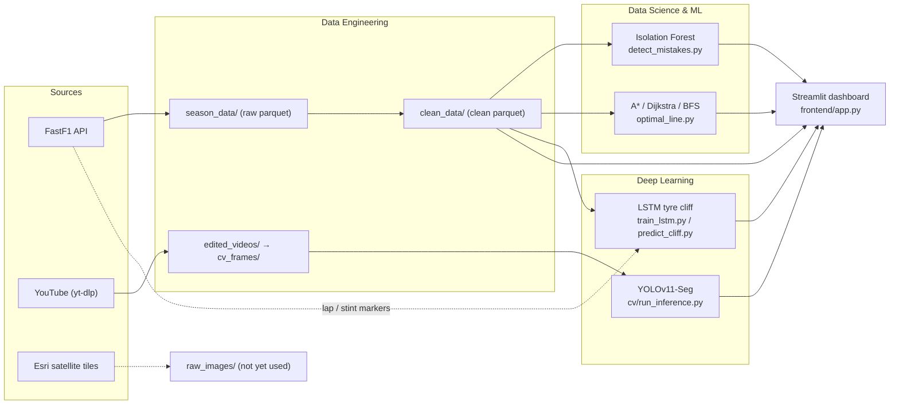

# ApexHunter 2.0 — Project Documentation

**Project Title:** ApexHunter 2.0 — F1 Telemetry & Onboard-Video Analytics Platform
**Courses:** Data Science & Machine Learning · Deep Learning
**Academic Year:** 2026–2027

| Sr. No. | Enrolment Number | Student Name |
|---|---|---|
| 1 | 23001091 | Parin Shah |
| 2 | 23000936 | Ayush Parikh |
| 3 | 23001119 | Malav Joshi |

> **Project history.** The first version of ApexHunter 2.0 was built in the previous semester
> (Jan–May 2026) for the *Artificial Intelligence* and *Big Data* courses. This semester the same
> codebase is being continued for *Data Science & Machine Learning* and *Deep Learning*. This
> document describes the project **as it currently exists in the code**. Section 8 lists every
> known limitation and is updated whenever the code changes.

---

## Table of Contents

1. [Overview](#1-overview)
2. [System Architecture](#2-system-architecture)
3. [Datasets](#3-datasets)
4. [Data Engineering Pipeline](#4-data-engineering-pipeline)
5. [Data Science & Machine Learning](#5-data-science--machine-learning)
6. [Deep Learning](#6-deep-learning)
7. [Dashboard](#7-dashboard)
8. [Current Status & Known Limitations](#8-current-status--known-limitations)
9. [Testing](#9-testing)
10. [How to Run](#10-how-to-run)

---

# 1. Overview

ApexHunter 2.0 analyses Formula 1 driving performance from two kinds of data:

- **Structured telemetry** for every driver in every qualifying and race session of the 2023 and
  2024 seasons (~57.9 million rows), fetched via the FastF1 library.
- **Unstructured onboard video** of the pole-position lap of every 2023 and 2024 Grand Prix
  (46 videos).

The telemetry and video feed four analytical components, and an interactive Streamlit dashboard
presents the results:

| Component | Technique | Course | Question it answers |
|---|---|---|---|
| Driver mistake detection | Isolation Forest (unsupervised anomaly detection) | DSML | Where in a session did the driver deviate from normal driving? |
| Racing-line search | A\*, Dijkstra, BFS on a telemetry-weighted grid | DSML (optimisation / search) | What is the lowest-cost path through the driver's own telemetry footprint? |
| Tyre cliff prediction | Stacked LSTM with Monte Carlo dropout | Deep Learning | When does pace drop off within a tyre stint? |
| Apex detection | YOLOv11-Seg instance segmentation (transfer learning) | Deep Learning | How close does the car come to the apex curb at each corner? |

**Planned this semester** (see [ROADMAP.md](ROADMAP.md)): each problem becomes a simple baseline →
machine learning → deep learning comparison. Mistake detection: Z-score vs the reworked Isolation
Forest vs an LSTM autoencoder. Tyre/pace prediction: Ridge regression vs a vanilla RNN vs the LSTM.
This document is updated as each part is built.

The project also includes supporting data infrastructure from the previous semester: a pandas ETL
pipeline, an equivalent Apache Spark job, HDFS storage, and a MongoDB document store.

---

# 2. System Architecture



### Repository layout

```text
backend/
  config.json                 seasons, frame-extraction, inference thresholds, circuits, video URLs
  scripts/
    utils.py                  shared paths, config loader, logger, IST timezone
    detect_mistakes.py        Isolation Forest orchestrator
    train_lstm.py             LSTM training orchestrator
    predict_cliff.py          LSTM prediction orchestrator
    optimal_line.py           racing-line orchestrator
    etl/                      download_season_data, clean_telemetry, fix_parquet_timestamps,
                              download_manual_videos, download_satellite_images
    bigdata/                  hdfs_manager, spark_clean_telemetry, mongo_manager
    cv/                       extract_frames, select_training_frames, extract_turns,
                              run_inference, inference_geometry/masking/hud/io
    isolation_forest/         mistakes_features, mistakes_model, mistakes_io
    lstm/                     tyre_data, tyre_model, tyre_io
    racing_line/              racing_line_grid, racing_line_search, racing_line_io
    tests/                    unit/ (23 files), integration/ (5 files), run_tests.py
frontend/
  app.py, config.py
  components/                 sidebar, data_loader, header_bar, telemetry_charts, track_map,
                              cv_feed, ai_analysis, racing_line, bigdata_tab, bigdata_charts, scrubber
models/                       best.pt (YOLO), tyre_lstm.pt, tyre_scaler.pkl, tyre_config.json
data_lake/                    all data and model outputs (gitignored)
docs/                         this document and supporting reports
```

---

# 3. Datasets

## 3.1 Structured — FastF1 telemetry

| Property | Value |
|---|---|
| Source | Official F1 timing data via the `fastf1` Python library (v3.8) |
| Coverage | 2023 (22 rounds) and 2024 (24 rounds); Qualifying (Q) and Race (R) for each → 92 sessions |
| Rows | 57,874,119 |
| Size | 1,718 MB raw / 1,691 MB clean (snappy-compressed Parquet) |
| Granularity | One row per merged car-data/position sample; median interval ≈ 0.13 s (~7.7 Hz) |
| Typical size | ~420k rows per qualifying session, ~800k rows per race (20 drivers) |
| File naming | `{year}_{round}_{Q|R}.parquet`, e.g. `2023_1_Q.parquet` |

**Schema (clean data):**

| Column | Type | Meaning |
|---|---|---|
| `Date` | datetime | Absolute timestamp of the sample |
| `SessionTime` | timedelta | Time since session start, the main time axis |
| `Speed` | float32 | km/h |
| `RPM` | float32 | Engine revolutions per minute |
| `nGear` | int | Gear 0–8 |
| `Throttle` | float32 | Throttle pedal, 0–100 % |
| `Brake` | float32 | **Binary brake flag (0 = off, 1 = on).** FastF1 provides brake as a boolean, not a pressure. |
| `X`, `Y`, `Z` | float | Car position in FastF1 track coordinates |
| `Driver` | string | Car number as a string (e.g. `"1"` = Verstappen, `"44"` = Hamilton) |
| `Round`, `Session`, `Year` | int/str | Session identifiers |
| `Time` | timedelta | Synthesised by the cleaning step from the row index (see §8) |

## 3.2 Unstructured — onboard pole-lap video

| Property | Value |
|---|---|
| Source | YouTube, downloaded with `yt-dlp` (a few manually specified URLs in `config.json`) |
| Content | Onboard pole-position qualifying lap for each 2023 and 2024 round |
| Count / size | 46 videos; 2.3 GB downloaded, 1.8 GB after manual trimming to the lap |
| Format | MP4, ≤1080p |
| Extracted frames | 21,282 JPEGs at 5 fps (6.7 GB) |
| Annotated set | 506 frames selected (11 per video), labelled in Roboflow with two classes: `curb`, `road` |
| Exported dataset | 1,281 training images (after Roboflow augmentation) and 226 validation images |

## 3.3 Satellite imagery

24 circuit images (1280×1280 PNG, 76 MB) downloaded from Esri World Imagery with `staticmap`.
They are stored in `data_lake/raw_images/satellite_maps/` but the dashboard does not use them yet.

## 3.4 Data quality

| Issue | Observation | Handling |
|---|---|---|
| Missing values | Occasional NaN sensor packets | Rows with Speed, RPM, X and Y all missing are dropped; other gaps are forward-filled. In practice no rows were dropped (57,874,119 in = out). |
| Outliers | Throttle values up to 104 % appear in raw data | Clipping: Speed 0–380, RPM 0–15,000, Throttle 0–100, Brake 0–1 |
| Binary brake | `Brake` carries no pressure information | Treated as an on/off flag everywhere: a braking feature for the Isolation Forest, a fraction of braking samples per cell for the racing line, and fraction of the lap spent braking for the LSTM |
| GPS noise | X/Y jitter, especially at low speed | Not filtered |
| Imbalance | Races have ~2× the rows of qualifying sessions; DNFs truncate data | Models process each session independently |
| Selection bias | Onboard videos exist only for the pole sitter, which favours front-running teams | Acknowledged; CV results are per-lap case studies |

---

# 4. Data Engineering Pipeline

## 4.1 Extract — `etl/download_season_data.py`

For each configured season it reads the event schedule (the years in `config.json` are strings and
are converted to integers for FastF1); the highest round number is the season length. If the
schedule cannot be fetched, that season is skipped and reported rather than guessed. For each
round and each session type
(`Q`, `R`) it then loads the session with `fastf1` (`telemetry=True, laps=True, weather=False`) and
calls `laps.pick_drivers(d).get_telemetry()` for every driver. It keeps the 14 columns listed in §3.1
(without `Time`) and writes `data_lake/season_data/{year}_{round}_{type}.parquet`. Sessions whose
file already exists are skipped. API responses are cached in `cache/`. At the end the script
logs a count per outcome (saved, skipped, empty, partial, failed), lists any failed or partial
sessions, and exits with code 1 if there were any. A *partial* file (some drivers failed to load)
is still saved; delete it and re-run to retry those drivers.

## 4.2 Transform — `etl/clean_telemetry.py` (pandas)

| Step | Operation |
|---|---|
| 1 | Add any missing expected column (`Driver`→`"UNKNOWN"`, `Time`/`SessionTime`→index seconds, `nGear`→8, numerics→0) |
| 2 | Drop rows where Speed, RPM, X and Y are **all** NaN |
| 3 | Forward-fill all numeric columns |
| 4 | Clip Speed 0–380, RPM 0–15,000, Throttle 0–100, Brake 0–1 (binary flag) |
| 5 | Downcast Speed, RPM, Throttle, Brake, X, Y to `float32` |
| 6 | Write snappy Parquet to `data_lake/clean_data/` (via a temporary file renamed on completion; skips files that already exist) |

## 4.3 Spark equivalent — `bigdata/spark_clean_telemetry.py`

The same transformation written in PySpark 3.5.1 (`local[*]`, 4 GB driver memory). It reads either
local `season_data/` (as a `file:///` URI, because an installed Hadoop makes HDFS the default file
system) or `hdfs://localhost:9000/apexhunter/season_data`. Forward-fill uses
`last(..., ignorenulls=True)` over a window partitioned by year, round, session and driver and
ordered by `SessionTime`. Output is Parquet partitioned by `Year/Round/Session`, written to its own
folder, `clean_data_spark` (local `data_lake/clean_data_spark/` or `/apexhunter/clean_data_spark`),
never into the pandas `clean_data` folder. The last recorded run (HDFS mode, May 2026, before these
fixes) processed 57,874,119 rows in 78 s and wrote 1,740 MB; a local run after the fixes processed
the same 92 files and rows in 99 s. A run log is written to `data_lake/spark_run_log.json`, and a
failed run exits with code 1.
`etl/fix_parquet_timestamps.py` rewrites Parquet timestamps to microsecond precision so that Spark
can read them.

## 4.4 Storage — HDFS and MongoDB

- `bigdata/hdfs_manager.py` wraps `hadoop fs` commands to upload `season_data`, `clean_data` (the
  pandas output) and `mistake_data` to `/apexhunter/...`, verify uploads, and write
  `data_lake/hdfs_status.json`. The status lists files recursively and also covers Spark's
  `/apexhunter/clean_data_spark`; folders and Hadoop marker files (`_SUCCESS`, `.crc`) are not
  counted as files. The stored status (May 2026) predates this and still shows Spark's output in
  `clean_data` as three "files" (`Year=2023`, `Year=2024`, `_SUCCESS`) until HDFS is re-run.
- `bigdata/mongo_manager.py` (database `apexhunter` on `localhost:27017`) upserts:
  - `mistake_annotations`: one document per session × driver (session keyed by file name, e.g.
    `2023_1_R.parquet`), containing the Isolation Forest metadata plus summary statistics
    (mean/std anomaly score, mistake rate, speeds).
  - `telemetry_sessions`: one metadata document per session file (92 documents).

  It also provides query helpers (leaderboard, per-driver history) and writes
  `data_lake/mongo_status.json`. One MongoDB client is shared per process.

These systems are optional at runtime. The dashboard reads their JSON status files and falls back
gracefully when HDFS or MongoDB are offline; it checks whether MongoDB is reachable at most once a
minute, so an offline MongoDB does not slow down every interaction.

---

# 5. Data Science & Machine Learning

## 5.1 Exploratory data analysis

EDA lives in the dashboard (Telemetry and Big Data tabs):

- Five-panel time series of Speed, Throttle, Brake, Gear and RPM with a time scrubber.
- Speed-coloured track map built from X/Y coordinates.
- Speed distribution histograms for the five drivers with the most samples.
- Pearson correlation heatmap of Speed, RPM, Throttle, Brake, X, Y, Z and nGear.
- Speed vs RPM scatter coloured by gear, which shows the gear-ratio bands.
- Brake/throttle overlap percentage for the selected driver (share of samples at ≥ 50 km/h with
  the brake on and throttle > 5 %; slower samples are excluded because in the garage, pit box or
  on the grid both pedals are often held on purpose).

## 5.2 Driver mistake detection — Isolation Forest

**Files:** `detect_mistakes.py`, `isolation_forest/mistakes_features.py`, `mistakes_model.py`,
`mistakes_io.py`

> **Status:** this section describes the current (last-semester) method, which has known flaws
> (§8 #3). It is being replaced by the rework designed in
> [ISOLATION_FOREST_REWORK.md](ISOLATION_FOREST_REWORK.md); this section is rewritten when the
> rework lands.

### Idea
Isolation Forest is an unsupervised anomaly detector. It builds random trees that split on random
features at random thresholds. Points that are isolated after few splits (short average path length)
are anomalous. The model learns "normal driving" from the target driver together with a reference
driver, then flags the target driver's samples that are hard to explain as normal.

### Feature engineering (7 features, all float32)

| Feature | Formula | Captures |
|---|---|---|
| `speed_normalized` | Speed / 380 | Absolute pace |
| `throttle_intensity` | Throttle / 100 | Throttle application |
| `brake_intensity` | 1 if brake on, else 0 | Braking (FastF1 has no brake pressure, so this is the on/off flag) |
| `brake_throttle_overlap` | 1 if brake on and Throttle > 5 % | Simultaneous pedal use, a sign of lock-ups, instability or poor technique |
| `speed_delta` | ΔSpeed clipped to ±50 | Sudden acceleration/deceleration |
| `gear_change` | \|ΔnGear\| clipped to 0–4 | Gear skips |
| `rpm_normalized` | RPM / 15,000 | Engine load |

> **Note:** FastF1's `Brake` is binary, so `brake_intensity` is the on/off flag itself rather than
> a normalised pressure. Before October 2026 the code divided it by 100 and used a `> 5` threshold,
> which made both brake features carry no signal. That bug is fixed.

### Training procedure

1. Load the clean session; check that `Driver, Speed, RPM, Throttle, Brake, X, Y, SessionTime, nGear` exist.
2. Choose the **reference driver** = highest mean speed in the session (or in a separate `--reference` file).
3. Engineer features for the target and reference drivers and concatenate them as the training set.
4. **Contamination grid search with 5-fold CV:** contamination ∈ {0.005, 0.01, 0.015, 0.02, 0.03, 0.05};
   KFold(5, shuffle, seed 42); each fold is scored by the mean |decision_function| on the held-out fold.
   The highest-scoring value is selected (6 × 5 = 30 fits, 200 trees each).
5. Fit the final `IsolationForest(n_estimators=200, max_samples="auto", random_state=42)` on all training rows.
6. Score the **target driver only**: `anomaly_score = decision_function`, `is_mistake = predict == -1`.

### Outputs
- `data_lake/mistake_data/{session}_{driver}_mistakes.parquet` contains the original telemetry plus
  `anomaly_score`, `is_mistake` and the 7 features.
- `..._mistakes_meta.json` holds the session, driver, reference driver, best contamination, CV
  score per contamination value, total rows and mistakes, mistake rate, tree count, feature list and
  timestamp.

### Current results (2023 Bahrain GP race, driver #1)

| Metric | Value |
|---|---|
| Rows scored | 42,381 |
| Rows with brake on / brake + throttle overlap | 8,556 (20.2 %) / 65 |
| Flagged samples | 212 (0.50 %) |
| Flagged samples under braking / with pedal overlap | 201 / 5 |
| Selected contamination | 0.005 |
| Reference driver | #1 (Verstappen was also the fastest by mean speed, so the baseline is his own) |
| CV scores | 0.005 → 0.196, 0.01 → 0.171, 0.015 → 0.154, 0.02 → 0.145, 0.03 → 0.133, 0.05 → 0.116 |

The CV score falls steadily as contamination grows. Mean |decision_function| shrinks as the
threshold moves into the bulk of the data, so this criterion will always favour the smallest
value in the grid. It is not a real model-selection signal (see §8). Now that the brake features
carry information, 95 % of flagged samples are braking samples: the model treats braking itself as
unusual. This is a target for the planned Isolation Forest improvements.

### Usage
```bash
python backend/scripts/detect_mistakes.py --session data_lake/clean_data/2023_1_R.parquet --driver 1 [--reference <file>] [--output-dir <dir>] [--force]
```

## 5.3 Racing-line search — A\*, Dijkstra, BFS

**Files:** `optimal_line.py`, `racing_line/racing_line_grid.py`, `racing_line_search.py`, `racing_line_io.py`

This component uses classical search and optimisation rather than learning. It sits with DSML as
the optimisation part of the pipeline.

### Graph construction
- The driver's X/Y samples for the **whole session** are binned into square cells (default 50 track
  units). Each occupied cell becomes a node holding its mean speed, mean brake and sample count.
- Node cost = `max(0.01, 1 − mean_speed/380 + 2 · brake_fraction)`, where `brake_fraction` is the
  share of the cell's samples with the brake on (0–1). Faster cells are cheaper; cells where the
  driver is usually braking are more expensive.
- 8-connected grid. Edge cost = average of the two node costs × (1 for orthogonal, √2 for diagonal moves).
- Distances are converted to metres with FastF1's documented position unit: X/Y are in 1/10 m,
  so the scale is a constant 0.1 m per unit for every circuit. We checked this by integrating
  speed over fastest laps at Bahrain, Monaco, Silverstone and Spa (0.0996–0.1006 m/unit).

### Search
- The driver's fastest lap is taken from FastF1 (`laps.pick_drivers(driver).pick_fastest()`) and
  the telemetry is sliced to that lap's start and end times. If FastF1 has no valid fastest lap
  for the driver, the run stops with an error; it never falls back to the whole session.
- The search is split into four legs between five waypoints taken at 0, ¼, ½, ¾ and the end of
  that lap, and the legs are concatenated.
- **A\***: heuristic = Euclidean grid distance × minimum node cost. This never overestimates, so A\*
  is optimal.
- **Dijkstra**: the same search with h = 0. It is the ground-truth check for A\*.
- **BFS**: ignores costs and finds the fewest hops. Its weighted cost is computed afterwards for comparison.

### Time estimate
A path's time is estimated by splitting it into segments and dividing each segment's length by
the speed of the nearest sample of the driver's fastest lap. The driver's own full-resolution lap
is timed the same way, and "time saved" = driver estimate − path estimate (positive = faster).
Because both use the same speeds, the comparison is like-for-like. Applied to the driver's lap,
the estimate is within about 1 % of the real lap time, so smaller differences are noise.

### Outputs
`data_lake/racing_lines/{session}_{driver}_racing_line.json` contains the driver's fastest-lap path
(every 10th sample), the FastF1 lap it came from (`fastest_lap`: lap number, lap time, measured
length in km, and `estimated_time_s`, the time estimate applied to that lap), the scale (`coordinate_scale`, 0.1), and for each algorithm: path, cost, nodes
expanded, compute time, estimated time saved and a found flag. It also holds per-segment deviation
between the A\* path and the driver path.

### Current results — 2023 Bahrain qualifying, driver #1 (Verstappen)
Fastest lap from FastF1: lap 14, 89.708 s (his pole time), 5.34 km of driven path (official
circuit length 5.412 km). Grid: 1,398 cells at resolution 50 (5 m).

| Algorithm | Path cost | Nodes expanded |
|---|---|---|
| A\* | 966.88 | 2,616 |
| Dijkstra | 966.88 | 2,723 |
| BFS (fewest hops) | 990.38 | 2,707 |

- A\* and Dijkstra find the same optimal cost; A\* expands about 4 % fewer nodes. BFS ignores
  cell costs, so its path is 2.4 % more expensive.
- The driver path has 66 points; the A\* path has 991 cells, about 5.34 km long.
- Deviation between the A\* path and the driver's line is 0.4–1.3 m per segment, which is within
  one 5 m grid cell.
- Time estimate check: the driver's lap is estimated at 88.76 s against the real 89.708 s (1 % low).
- Estimated time saved: A\* and Dijkstra −0.08 s, BFS −0.10 s, i.e. about 0.1 % slower than the
  driver and well inside the estimate's ~1 % error. **The search finds no faster line** through
  the driver's own telemetry footprint. This is expected: the graph only contains cells the
  driver already drove, and the node cost (speed and braking) is not a lap-time model, so the
  "optimal" path mostly retraces the driver's line (median 2.4 m from it).

### Usage
```bash
python backend/scripts/optimal_line.py --session data_lake/clean_data/2023_1_Q.parquet --driver 1 [--resolution 50] [--n-corners 16] [--force]
```

---

# 6. Deep Learning

## 6.1 Tyre cliff prediction — LSTM

**Files:** `train_lstm.py`, `predict_cliff.py`, `lstm/tyre_data.py`, `tyre_model.py`, `tyre_io.py`

### Problem
Tyre performance degrades over a stint and at some point drops sharply (the "cliff"). Knowing when
helps with pit-stop timing. The model is framed as a sequence-regression task: given the last 5
laps of a stint, predict the next lap's pace.

### Data preparation
1. Race sessions are processed in chronological order (by year, then round). For each one, FastF1 lap data (`LapStartTime`, `Time`, `Stint`, `Compound`, `TyreLife`,
   `LapNumber`, `LapTime`) is loaded and joined to the clean telemetry by session time.
2. Each lap is aggregated into 9 features: mean speed, mean throttle, mean brake (fraction of the
   lap spent braking), mean RPM, tyre age,
   one-hot compound (soft/medium/hard) and race lap number.
3. **Only representative laps are used.** Excluded: lap 1 (standing start), out-laps and in-laps
   (pit stops), laps run under safety car, VSC or red flag (FastF1 `TrackStatus` 4/5/6/7), deleted or
   FastF1-generated laps, laps with no lap time, and laps FastF1 marks as inaccurately timed.
   Yellow-flag laps are kept, because yellows are local and barely affect lap pace. On real races
   this removes about 13–16 % of laps; on the 2023 Bahrain and 2024 Miami races, 26–29 % of the
   windows built by the earlier, unfiltered pipeline contained at least one such lap.
4. Laps are grouped by stint. Stints with fewer than 3 usable laps are discarded.
5. Sliding windows of 5 laps → target = **mean speed of the following lap** (km/h). Windows are built
   only within runs of consecutive representative laps, so a window never bridges a removed lap
   (e.g. a safety-car period).
6. **Split by whole sessions, chronologically:** the most recent 10 % of race sessions form the
   test set, and the most recent 20 % of the remaining sessions form the validation set. Splitting
   by session rather than by sequence matters: neighbouring sliding windows share 4 of their 5 laps,
   so a per-sequence split would put near-identical samples on both sides.
7. `StandardScaler` (features) and z-normalisation (target) are fitted on the **training sessions
   only** and then applied to validation and test data, so no test statistics leak into training.

### Architecture

| Component | Value |
|---|---|
| Layers | 2 stacked `nn.LSTM` layers, `batch_first=True` |
| Hidden size | Selected by grid search from {32, 64, 128} |
| Dropout | 0.3 between LSTM layers |
| Head | Linear(hidden → 1) on the last time step |
| Loss / optimiser | MSE / Adam |
| Batch size | 32 |

### Hyperparameter search
6-configuration grid over hidden size and learning rate
(32/1e-3, 64/1e-3, 128/1e-3, 32/5e-4, 64/5e-4, 128/1e-4). Each configuration is trained for 20 epochs
and scored by best validation MSE. The final model is trained for 50 epochs with the winning
configuration. During every training run the weights from the best-validation epoch are kept and
restored at the end, so the saved model is the one that achieved the reported validation MSE.

### Inference and uncertainty
- **Monte Carlo dropout:** dropout stays active and 10 forward passes are averaged; mean ± 1 σ gives
  the confidence band.
- Predicted mean speed is converted to lap time with an estimated lap distance (mean speed × lap
  time over the stint's valid laps).
- A lap is predicted only when the 5 laps before it are consecutive representative laps, the same
  rule as the training windows. The first 5 laps of a stint, and the 5 laps after any removed lap
  (e.g. a safety-car period), have no prediction (`null`). The model is therefore never fed padding
  or a window that skips a lap, and no lap is predicted from its own data.
- Every stint with at least 3 representative laps is reported, including stints too short for any
  prediction (actual lap times only). Across 8 races (2023–24 R1–R4) 51 of 391 stints (13 %) are
  like this, e.g. Verstappen's first stint in the red-flagged 2023 Australian GP.
- The cliff lap is the first predicted lap after the best predicted lap whose predicted time exceeds
  the best by more than 1.5 s. `laps_remaining` = stint length − cliff lap.
- Output: `data_lake/tyre_predictions/{session}_{driver}_tyre.json` with one entry per stint:
  `stint_index`, `n_laps`, `lap_numbers` (race lap number of each kept lap; numbers can skip removed
  laps), `actual_laps`, `predicted_laps`, `confidence_upper`, `confidence_lower` (the last three
  `null` for laps without a 5-lap history), `cliff_lap`, `laps_remaining`.

### Model compatibility
`tyre_config.json` records the feature names the model was trained on. Before loading,
`load_model_artifacts` checks them (and the input size) against the current code and raises a clear
"retrain with `train_lstm.py --force`" error on any mismatch.

### Results
**Retraining pending.** The saved model in `models/` is from April 2026, trained on an earlier
8-feature version and with the old (leaky) split. It reported val MSE 0.151 (normalised) and test
MAE 5.15 km/h; those numbers are not comparable with the corrected pipeline. `predict_cliff.py`
refuses to load it. The model will be retrained once the remaining LSTM-related changes are done.
The existing prediction file (2023 Bahrain race, #1) was produced by that old model and pipeline
(no lap filtering, no `lap_numbers`); it detected a cliff in stint 3 at lap 10 of 21. The dashboard
shows "Lap in stint" for such older files and real race lap numbers for new ones.

### Usage
```bash
python backend/scripts/train_lstm.py [--seasons 2023 2024] [--test-split 0.1] [--force]
python backend/scripts/predict_cliff.py --session data_lake/clean_data/2023_1_R.parquet --driver 1 [--force]
```

## 6.2 Apex detection — YOLOv11-Seg

**Files:** `cv/extract_frames.py`, `cv/select_training_frames.py`, `cv/run_inference.py`,
`cv/inference_geometry.py`, `cv/inference_masking.py`, `cv/inference_hud.py`, `cv/inference_io.py`,
`cv/extract_turns.py`

### Dataset construction
1. `extract_frames.py` extracts frames from each trimmed video at 5 fps in parallel (`ProcessPoolExecutor`), giving 21,282 frames.
2. `select_training_frames.py` takes 11 evenly spaced frames per video, giving 506 frames named `{year}_{video}_{frame}.jpg`.
3. The frames were annotated in Roboflow with polygon masks for **`curb`** (class 0) and **`road`** (class 1).
4. Roboflow augmentation (flips, crops, colour/brightness shifts, small rotations) produced the
   exported dataset of 1,281 training and 226 validation images (`data_lake/cv_dataset/data.yaml`).

### Model and training
YOLOv11-Seg was fine-tuned from COCO-pretrained weights on a Google Colab T4 GPU (transfer learning,
all layers trainable). The trained weights are `models/best.pt` (6 MB). The Colab training logs
(mAP50 / mAP50-95 for boxes and masks) are not stored in this repository (see §8).

### Turn windows from FastF1 (`extract_turns.py`)
The pipeline needs to know, for every moment of the video, whether the car is in a corner, which
way it turns, and how fast the corner is. These **turn windows** are built from FastF1 data:
1. **Corners** come from FastF1's official circuit information (`session.get_circuit_info().corners`:
   corner number and distance along the lap), so every corner is included. Bahrain has 15.
2. The **pole lap** is the pole sitter's fastest qualifying lap. Its telemetry gives the lap time at
   which each corner's distance is reached (the apex time). Each window spans 50 m of track before
   and after the apex; where neighbouring windows would overlap, the boundary is placed halfway
   between the apexes.
3. **Direction** is the sign of the GPS heading change over ±30 m around the apex.
4. **Speed class** comes from the minimum speed inside the window: Slow < 100 km/h ≤ Medium ≤
   200 km/h < Fast.
5. **Video offset (manual input):** onboard videos are trimmed by hand, so the timed lap starts a
   few seconds into the video (4.9 s for 2024 Bahrain). This one number per video is passed with
   `--video-offset` and added to every window.

Year, round and driver are read from the video path (`edited_videos/{year}/{round}_{venue}_{drv}_pole
- Trim.mp4`). The windows are saved as `processed_csv/{video}_turns.json` and used both by the
inference loop and by the dashboard's turn-by-turn report card.

Validated against windows hand-annotated from the 2024 Bahrain video: all 15 corners found; apex
times within 0.37 s on average (max 1.3 s, T12, a flat-out kink); window edges within about 0.6 s;
direction agrees for 14 of 15 corners. The exception is T5, a ~10° kink that telemetry reads as a
slight right. Automatic offset detection from the YOLO output is not possible because a curb is
detected in about 99 % of frames, straights included (curbs line the track everywhere). This was
also why corner windows are needed to separate apex curbs from straight-line curbs.

This replaced (a) windows typed in by hand for one Bahrain video, duplicated in the frontend, and
(b) an earlier `extract_turns.py` that detected corners from GPS curvature and merged nearby
corners (it found 11 of Bahrain's 15).

### Inference pipeline (`run_inference.py`)
For every video frame:
1. YOLO prediction (confidence 0.25, `retina_masks=True`) produces curb and road masks at the
   frame's full resolution, with the network's letterbox padding removed.
2. **Masking:** masks are drawn into a colour overlay (curb red, road
   green). Curb contours on the wrong side of the screen for the expected turn direction are
   discarded (except in fast corners), and the largest remaining contour is kept.
3. **Geometry:** the contour's inner (track-side) edge is extracted. The minimum Euclidean distance
   is measured from a fixed front-wheel reference point (left wheel 18 % / right wheel 85 % of width,
   60 % of height; the side is chosen by turn direction).
4. **Temporal smoothing:** an exponential moving average (α = 0.15) is applied to the closest point
   and the distance.
5. **Classification** uses thresholds from `config.json` (hit 130 px, near 250 px), scaled ×0.75 in
   slow corners and ×1.35 in fast corners:
   `Hitting Apex` / `Near Apex` / `Wide Line` (fast corners) / `Missing Apex`. Frames outside a turn
   window are `Straight`. Frames inside a turn with no usable curb are `Tracking`. Distances above
   900 px are treated as "no apex curb".
6. **HUD rendering:** a blended mask overlay, wheel markers, a dotted tether to the curb, a pulsing
   target ring, a projected Bézier trajectory, a blurred info panel and a depth-scaled distance label.
7. The output video is re-encoded to H.264 with ffmpeg when it is available.

Outputs:
- `data_lake/processed_video/{video}_HUD.mp4`
- `data_lake/processed_csv/{video}_turns.json`: the turn windows used for this run, the video
  offset, and which lap the video shows (`lap`: year, round, session, driver, driver number, and the
  lap's start/end in session seconds; for Bahrain 2024: 4,354.1–4,443.3 s).
- `data_lake/processed_csv/{video}_metrics.csv` with columns `frame_number, timestamp_sec,
  distance_cm, status, has_curb`. `distance_cm` is the pixel distance × 0.155, an approximate
  calibration.

### Current results (2024 Bahrain pole lap, Verstappen, 4,917 frames at 50 fps, offset 4.9 s)

| Status | Frames |
|---|---|
| Straight | 3,241 |
| Missing Apex | 512 |
| Tracking | 448 |
| Near Apex | 343 |
| Hitting Apex | 274 |
| Wide Line | 99 |

Turn-by-turn report card: each corner is rated by the status of its closest-approach frame (the
same per-frame thresholds as above). 12 of 15 corners "Hitting Apex", T5 "Near Apex" (33 cm, fast
corner), T9 and T15 "Missing Apex" (38 and 51 cm in medium corners, where "near" ends at 250 px ≈
39 cm). Before #35 the card used its own 30/60/150 cm cut-offs and showed T9 and T15 as "Near
Apex". Regenerated in Oct 2026 after the mask-alignment fix (#26); 66 frames (1.3 %) changed status. The processed video is the 2024 one (confirmed by frame comparison); an older
code comment had labelled the hand-typed windows "Bahrain 2023".

### Usage
```bash
python backend/scripts/cv/extract_frames.py
python backend/scripts/cv/select_training_frames.py
python backend/scripts/cv/extract_turns.py --video "data_lake/edited_videos/2024/01_bahrain_ver_pole - Trim.mp4" --video-offset 4.9   # preview windows
python backend/scripts/cv/run_inference.py --input "data_lake/edited_videos/2024/01_bahrain_ver_pole - Trim.mp4" --video-offset 4.9 [--force]
```

---

# 7. Dashboard

`streamlit run frontend/app.py`. Data loads are cached with `@st.cache_data`.

| Area | Content |
|---|---|
| Sidebar | Year → Session → Driver selectors, plus green/grey status dots showing whether Isolation Forest, LSTM and racing-line outputs exist for the selection |
| Header | Track name, fastest lap (FastF1), top speed, driver number/name/team |
| 🏎 Race Intelligence | Master session-time scrubber (linked to the Telemetry-tab slider: moving either moves both, and every tab uses that time); processed CV video with an apex-status badge that follows the scrubber while it is inside the video's lap (select that session and driver; otherwise it shows "Not in this lap"), status counts and a turn-by-turn report card; track map in Speed or Mistakes mode with a lap selector |
| 📊 Telemetry | Speed/Throttle/Brake (on/off)/Gear/RPM subplots with a scrubber line; top speed and brake-overlap % (brake on and throttle > 5 %, counted over samples at ≥ 50 km/h) |
| 🧠 AI Analysis | Isolation Forest track map with mistake markers per lap, plus anomalies, mistakes under braking and measured mistake rate for the selected lap; LSTM stint chart with predicted pace, confidence band and cliff marker |
| 🛣 Racing Line | Track outline with the driver's fastest lap and the selected algorithm's path; deviation per turn |
| 🗄️ Big Data | Pipeline DAG, HDFS and Spark statistics from the JSON logs, EDA charts for the selected session, LSTM and pathfinding summaries, live MongoDB leaderboard |

---

# 8. Current Status & Known Limitations

This section is kept up to date as fixes are made. Which issues will be fixed, and in what order,
is decided in [ROADMAP.md](ROADMAP.md).

### Progress and next steps (Oct 2026)
1. **Bug fixes: done.** All bugs found in the code review (ROADMAP #1–#40) are fixed, except the two
   that belong to planned reworks (Isolation Forest #8/#9, LSTM features #22).
2. **Test audit rounds 2–3: done** (only essential tests, no mocks; 145 tests, all passing).
   **Next: the Isolation Forest rework + Z-score baseline** (DSML).
3. Then the Ridge baseline (DSML), the LSTM rework with vanilla RNN vs LSTM and the LSTM
   autoencoder (DL), outputs for more sessions, and finally the dashboard redesign.
The step-by-step plan and the rules for working on the project are in ROADMAP §0 and §3.

### Working
- CI/CD configuration added (29 Oct 2026): Docker build, fatal-error/dependency checks, unit
  tests and Streamlit startup check; GHCR publication on pushes to `main` and an optional
  deployment hook. Local static checks passed; full CI execution/publication and hosting are
  unverified. See [CI_CD.md](CI_CD.md) for the YAML explanation and activation steps.
- Telemetry download and cleaning for all 92 sessions; Spark, HDFS and MongoDB integration (last run May 2026).
- Isolation Forest, racing-line and CV inference pipelines run end to end.
- Dashboard with all five tabs.
- Test suite: 145 tests, all passing (127 unit + 18 integration); no mock tests (test audit rounds 2–3).

### Fixed
- **30 Oct 2026 – CI dashboard test compatibility.** The first container run passed Docker
  build, Ruff and dependency checks and ran all 127 unit tests without skips. The dropdown-lock
  test failed because it selected only Streamlit's former `UnknownElement` representation.
  It now uses `at.get("html")` while retaining its real script and JavaScript-flag assertions.
  The CI rerun is pending; see [CI_CD.md](CI_CD.md).
- **Oct 2026 – Binary brake handling.** `Brake` is now treated as an on/off flag across cleaning
  (pandas and Spark clip 0–1), Isolation Forest features, racing-line node cost and the dashboard.
  The Telemetry tab shows "Brake (on/off)" as a step line, brake overlap means brake on and
  throttle > 5 %, and the AI tab card is renamed "Under Braking". Outputs regenerated.
- **Oct 2026 – Scripts runnable by file path.** The 12 runnable scripts in `etl/`, `bigdata/` and
  `cv/` add `backend/scripts` to `sys.path`, so `python backend/scripts/etl/clean_telemetry.py`
  works as well as `python -m etl.clean_telemetry`. Covered by `test_script_entrypoints.py`.
- **Oct 2026 – Test runner interpreter.** `run_tests.py` launched tests with a bare `python`, which
  on Windows resolved to the system interpreter instead of the project venv. It now uses
  `sys.executable`.
- **Oct 2026 – LSTM training pipeline.** Sessions are now processed chronologically (round 10 used to
  sort before round 2); the test/validation splits hold out whole sessions; scalers are fitted on
  training data only; the best-validation-epoch weights are restored instead of keeping the last
  epoch; and incompatible saved models are rejected with a clear message. `train_lstm.py` exposes
  `run_training()`, which the LSTM integration test now runs end to end (it previously
  re-implemented the pipeline inline and crashed on a pre-refactor import).
- **Oct 2026 – LSTM lap filtering.** Lap 1, out/in-laps, SC/VSC/red-flag laps, deleted, generated,
  untimed and inaccurately-timed laps are excluded; training windows never bridge a removed lap;
  the prediction step no longer overwrites each stint's first lap with the second; and predictions
  record real race lap numbers, which the dashboard uses for its x-axis.
- **Oct 2026 – AI tab mistake rate.** The "Mistake Rate" card showed the contamination
  hyperparameter (e.g. 0.005) instead of the measured rate, and the caption repeated contamination
  where the rate belonged. The card now shows the selected lap's measured rate (matching the other
  per-lap cards) and the caption shows the session-wide rate alongside the contamination setting.
- **Oct 2026 – Single FastF1 cache and complete requirements.** FastF1 data was cached in three
  places: `cache/` (ETL, dashboard), `data_lake/cache/` (LSTM prediction) and FastF1's OS default
  folder outside the project (racing line, which never configured a cache). All backend code now
  calls `utils.enable_fastf1_cache()`, so everything uses `cache/`. `scipy` and `pillow`, which are
  imported directly, were added to `requirements.txt`. Unit tests guard both.
- **Oct 2026 – Deprecated Streamlit JavaScript injection removed.** The dashboard injected
  JavaScript through `st.components.v1.html` (deprecated) to stop users typing into dropdowns.
  All dropdowns now use Streamlit's native `selectbox(filter_mode=None)`, which blocks typing.
  Backspace/Delete would still clear a dropdown's shown value, so a small key-lock script blocks
  those two keys, injected with the supported `st.html(..., unsafe_allow_javascript=True)`.
- **Oct 2026 – CV turn windows from FastF1.** Hand-typed Bahrain windows (duplicated in the
  frontend with conflicting speed classes) and a curvature detector that found 11 of 15 corners
  were replaced by windows built from FastF1's official corner list and the pole lap's telemetry,
  plus a per-video offset. The dashboard report card reads the same saved windows.
- **Oct 2026 – Test-suite audit (step 1).** Weak, stale, circular and duplicate tests were fixed,
  merged or removed (249 → 230 tests, each checking real behaviour; details in `docs/TEST_AUDIT.md`).
  Bugs found on the way: training-frame selection never sampled the end of a video (now evenly
  spaced incl. first and last frame); racing-line start cells used a different grid origin from the
  grid; log lines with `→` were dropped on redirected Windows output (fixed for all scripts in
  `utils.setup_logger`); the racing line used FastF1's deprecated `pick_driver`.
- **Oct 2026 – Racing-line scale and fastest lap (#18, #19).** The metres-per-unit scale was
  estimated from the session length ÷ 90 s and a circuit length that defaulted to Bahrain, which
  made qualifying scales about 3× too large. It is now FastF1's documented 1/10 m, and
  `--circuit-length` is gone. The fastest-lap lookup used to fall back silently to the whole
  session (the stored output had 3,071 path points from every lap); the run now stops instead,
  and the output records which FastF1 lap was used. Unused start/end-node code was removed. The
  2023 Bahrain qualifying output was regenerated.
- **Oct 2026 – Season downloader (#25).** `config.json` stores the seasons as strings, which FastF1
  rejects (`TypeError`), so every session failed and the error was only logged. Years are now
  converted to integers. A failed schedule lookup used to fall back to 24 rounds (2023 had 22); the
  season is now skipped and reported. Per-driver failures are counted, and the run ends with a
  summary and a non-zero exit code when anything failed. Verified by re-downloading 2024 R1 Q
  (identical to the stored file: 380,399 rows, 20 drivers).
- **Oct 2026 – Linked time scrubbers (#31).** The master scrubber and the Telemetry-tab slider
  kept separate values: after the first load the Telemetry slider ignored the master (so its chart
  was cut at a different time from the "Session Time" card and scrub line), and moving the
  Telemetry slider was overwritten by the master on the next rerun. Both sliders now share one
  position (`components/scrubber.py`): moving either one updates the other through Streamlit
  `on_change` callbacks, and the position is clamped when a shorter session is selected. The
  card also rounded milliseconds down (1622.599 s showed as 27:02.598); it now rounds. Covered by
  `test_frontend_scrubber.py`, which drives both sliders with Streamlit's AppTest.
- **Oct 2026 – Projected-pace colour (#32).** The AI tab's "Proj. End Pace" delta was red whether
  the projection was faster or slower: the code switched Streamlit's colour mode by the sign of the
  delta, and both combinations render red. Lap-time deltas now always use the "inverse" mode
  (faster = green, slower = red). Covered by an AppTest of the LSTM panel.
- **Oct 2026 – Brake-overlap card (#33).** The Telemetry tab's "Brake Overlap" counted every
  sample, including the car standing in the garage with the brake held and the throttle blipped.
  Those samples dominated the figure (2023 R1 Q #1: 21.27 %; 2024 R1 Q #11: 6.05 %, where 1,447
  of 1,541 overlap samples were at 0 km/h). It now counts only samples at ≥ 50 km/h (0.41 % and
  0.67 %). The threshold barely matters between 0 and 80 km/h, because the remaining overlaps are
  on-track moments, mostly the switch from throttle to brake. The card shows two decimals and
  says which samples it counts.
- **Oct 2026 – YOLO mask alignment (#26).** YOLO predicts on a 384×640 letterboxed image (with
  grey padding bars). The masks were stretched straight onto the 1080×1920 frame without removing
  that padding, so curb and road edges sat up to ~29 px from where YOLO had actually found them
  (curb-mask overlap with the true outline as low as IoU 0.41). Inference now uses
  `retina_masks=True`, which returns full-resolution masks with the padding removed (IoU 1.00
  against YOLO's own outlines on every mask checked). The Bahrain video was re-processed: 66 of
  4,917 frames changed status, the median apex distance changed by 1 cm, and the turn-by-turn
  results stayed the same (12 "Hitting Apex", 3 "Near Apex").
- **Oct 2026 – Racing-line time estimate (#39).** "Time saved" was path length ÷ mean speed of the
  cells along the path, with cell speeds averaged over the whole session (out-laps and in-laps
  included). That estimated Verstappen's 89.7 s pole lap at about 110 s and rewarded A\* simply for
  passing through fast cells, giving about +9 s, hidden by a ±5 s clamp (5.0 for all three
  algorithms). Paths are now timed segment by segment with the speed of the nearest fastest-lap
  sample, the driver's lap is timed the same way, and the clamp is gone. The driver's lap is now
  estimated within 1 % (88.76 s); the algorithms come out 0.08–0.10 s slower than the driver.
- **Oct 2026 – LSTM prediction windows (#20, #21).** Prediction dropped every stint that could not
  form a training window (13 % of race stints), and for the stints it kept, it predicted every lap by
  padding the start with copies of the first lap and sliding across removed laps; the first lap's
  prediction even used that lap's own data. These were fixed together because they live in the same
  function: letting short stints through with the old windows would have produced predictions made
  entirely of padding. Now training and prediction share one rule (`tyre_data.window_positions`): a
  lap is predicted only from the 5 consecutive kept laps before it. Other laps are `null`, and short
  stints are reported with their actual laps only. The dashboard charts skip `null` predictions.
- **Oct 2026 – UTF-8 text files (#23).** On Windows, `open()` defaults to the cp1252 encoding, so
  `config.json`'s "São Paulo Grand Prix" was read as "São Paulo Grand Prix" (a satellite-image
  re-run would have saved a second, misnamed copy). Every text-mode `open()` in the project now
  passes `encoding="utf-8"`, and a unit test fails if a new one does not.
- **Oct 2026 – Test runner skips (#24).** `run_tests.py --file` on an integration test ran it without
  `APEXHUNTER_RUN_SLOW`, so all of its tests were skipped, yet the runner printed PASS and "All tests
  passed". Integration files named with `--file` now run for real. The runner also reads
  unittest's counts: the summary shows tests run and skipped, and a file whose tests were all
  skipped is labelled SKIP instead of PASS.
- **Oct 2026 – HDFS/Spark layout and status (#27, #40).** Spark wrote its partitioned output into the
  same `clean_data` folder as the pandas files, both on HDFS and locally. Locally, `--force`
  would have deleted the pandas folder that every model reads. Spark now writes to
  `clean_data_spark`. The HDFS status listed folders and `_SUCCESS` as files; it now lists
  real files recursively. Spark's forward-fill never ran (#40: a type-name check that never matched
  in PySpark 3.5) and was grouped by driver only. It now runs within each driver's session, and
  the pandas cleaner fills within each driver. The raw data has no missing values, so no
  cleaned values change. Found on the way: local Spark mode had never worked on this machine
  (Hadoop made `C:\...` paths resolve on HDFS), failed runs exited with code 0, and
  `files_processed` was always 0. All fixed; verified by a local run (92 files, 57,874,119 rows,
  pandas `clean_data` untouched). HDFS itself was not re-run.
- **Oct 2026 – Manual video downloader (#28).** `etl/download_manual_videos.py` saved to
  `data_lake/raw_video/`, a folder nothing reads; it now saves to `downloaded_videos/{year}/` with the
  other videos. The config entry is one download batch (a year plus name → URL pairs); videos were
  collected in batches of six. It also deleted the existing video before downloading the replacement, so a failed
  download lost the file; it now downloads under a temporary name and replaces the old file only
  on success.
- **Oct 2026 – MongoDB handling (#29).** The Big Data tab pinged MongoDB on every rerun, so with
  MongoDB off every click in the dashboard waited ~3 s and logged the same error (measured: 3.08 s
  per rerun; now 0.01 s, re-checked once a minute). `mongo_manager` opened a new client for every
  call and never closed them; it now shares one client per process. Mistake documents were keyed
  by the session path exactly as typed (absolute and relative paths made duplicates); they are
  now keyed by file name, and an upload removes older copies stored under a full path.
- **Oct 2026 – CV and ETL robustness (#30).** A crashed or interrupted `run_inference` left partial
  outputs that the next run treated as "already processed" (the check also ignored
  `_turns.json`); partial outputs are now removed and all three files are required to skip. The
  ETL scripts write Parquet to a temporary file and rename it when complete, so a crash cannot
  leave a half-written file that is later skipped. The video frame rate is no longer truncated
  to a whole number (the videos run at 50.00–50.01 fps; the timing effect was ≤ 0.01 s), frame
  extraction can no longer divide by zero below 5 fps, the code's fallback apex thresholds now
  equal `config.json` (130/250 px instead of 300/550), and two docstrings that still called the
  FastF1 turn directions "hardcoded" were corrected. No outputs changed.
- **Oct 2026 – Big Data tab charts (#34).** The "Speed Trace Overlay" drew the EDA sample in its
  random (shuffled) order against a sample index, so it showed noise (median jump between plotted
  points 93 km/h). It now sorts each driver's samples by session time, plots speed against session
  time in minutes (median jump 2.6 km/h), breaks the line at time gaps over 10 s, and is titled
  "Speed Over Session Time". The LSTM band labelled "95% CI" is mean ± 1 standard deviation of the
  Monte Carlo dropout passes, and is now labelled "±1σ (MC dropout)".
- **Oct 2026 – CV panel (#35).** The live status badge converted session time to video time by
  subtracting the start of the selected session's telemetry, which gave times far past the end of
  the 98 s video, so it always showed the last frame. The turn windows file now records which lap
  the video shows and when it ran (from FastF1), and the badge maps the scrubber into the video
  only when that session and driver are selected and the scrubber is inside the lap. The
  turn-by-turn report card used its own centimetre cut-offs that disagreed with the per-frame
  classification; each corner now takes the status of its closest-approach frame (T9 and T15
  change from "Near Apex" to "Missing Apex").
- **Oct 2026 – Dashboard edge cases (#36, #37).** The round and session type now come from the
  session file name (`2024_1_Q.parquet`) instead of the label text, which fell back to Race when
  the FastF1 schedule was unavailable. Failed FastF1 lookups (lap boundaries, event names, fastest
  lap) are retried after 10 minutes instead of being cached until restart. The CV metrics are
  reloaded when the CSV changes; empty telemetry no longer stops every tab; and chart
  downsampling now works for 5,001–9,999 rows. Smaller presentation issues were moved to the UI
  redesign (ROADMAP §E).
- **Oct 2026 – Test audit round 2.** Only tests that guard real behaviour of main features were
  kept (252 → 168 tests). The old Isolation Forest tests, including the two failing integration
  files, were deleted; the rework writes their replacements. See `docs/TEST_AUDIT.md`.
- **Oct 2026 – Test audit round 3 (no mocks).** The 12 mock-based tests were removed or replaced.
  The racing-line and LSTM integration tests now run the real pipelines on real data (2023 Bahrain
  qualifying; 2024 races 1–4 with real FastF1 laps), checking real values such as Verstappen's lap
  14 / 89.708 s and LSTM lap-time predictions within 10 % (168 → 145 tests).
- **Oct 2026 – Code cleanup.** Unused imports, variables, constants and two dead functions
  removed (`ruff check --select F` now passes).

### Known issues (to be fixed)

CI/CD operational limits: no hosting is configured, so live deployment is skipped. Real-data
integration tests are not run in CI; the dataset, cache and models must be supplied separately.
The first GitHub run is still required to verify the full Docker build/test/publication path.
Existing Python requirements remain unpinned. See [CI_CD.md](CI_CD.md).

| # | Area | Issue |
|---|---|---|
| 2 | LSTM | The saved model predates the current 9-feature pipeline, so `predict_cliff.py` refuses to load it until it is retrained (deliberately deferred until other LSTM work is done). |
| 3 | Isolation Forest | The CV criterion always selects the smallest contamination. The reference driver can be the target driver. |
| 4 | CV | The video list is not filtered by the selected session (the live status badge only follows the scrubber for the video's own session and driver). YOLO training metrics are not in the repo. |
| 5 | Racing line | The search graph only contains cells the driver drove and its node cost is not a lap-time model, so it cannot find a faster line (estimated time saved ≈ −0.1 s, within the 1 % error of the time estimate). "Per-corner" deviation uses equal segments. Turn labels in the frontend are Bahrain-specific. The grid is built from all of the driver's session laps. |
| 6 | Outputs | Model outputs exist for only one session/driver each (mistakes and tyre: 2023 R1 race #1; racing line: 2023 R1 qualifying #1; CV: Bahrain pole lap). |
| 9 | Misc | `Time` is synthesised from the row index. Satellite images are unused. Team mapping is not season-specific. |
| 11 | Logging | The Isolation Forest grid-search log prints contamination with 2 decimals, so 0.005 shows as "0.01" (the Windows encoding crash on `→` is fixed). |
| 14 | Review (Oct 2026) | A full pre-commit review found further issues, logged as roadmap #18–#40. All are fixed except #22, which moved to the LSTM rework; a few dashboard presentation items from #37 moved to the UI redesign. |

---

# 9. Testing

| Suite | Files | Tests | Notes |
|---|---|---|---|
| Unit | 23 | 127 | Frame selection, CV geometry/classification/turn windows, racing-line grid/search/I/O (incl. cost-aware detours and the time estimate), LSTM data/lap filtering/prediction windows/training/model/I/O (incl. a learnability check), telemetry cleaning, dashboard (AI tab, dropdowns, linked scrubbers, brake-overlap card, CV badge time mapping), project guards (script entry points, FastF1 cache, requirements, logging, UTF-8 file handling). All pass. Isolation Forest tests are being rewritten with the rework. Audit: `docs/TEST_AUDIT.md`. |
| Integration | 5 | 18 | Real data, no mocks: racing line on 2023 Bahrain qualifying (fastest lap, scale, time estimate, A\* = Dijkstra), LSTM train → predict on real 2024 races 1–4 with real FastF1 laps, FastF1 turn windows vs the hand-annotated Bahrain 2024 lap, Isolation Forest pipeline edge cases and skip/force. Run with `--all`; skipped if `data_lake/` or `cache/` is absent. All pass. |

```bash
python backend/scripts/tests/run_tests.py          # unit tests
python backend/scripts/tests/run_tests.py --all    # unit + integration
python backend/scripts/tests/run_tests.py --file <test file>   # one unit or integration file
```

---

# 10. How to Run

```bash
python -m venv .venv
.venv\Scripts\activate
pip install -r requirements.txt

# Data (already present in data_lake/ on the development machine)
python backend/scripts/etl/download_season_data.py
python backend/scripts/etl/clean_telemetry.py

# Models
python backend/scripts/detect_mistakes.py --session data_lake/clean_data/2023_1_R.parquet --driver 1
python backend/scripts/train_lstm.py --force
python backend/scripts/predict_cliff.py --session data_lake/clean_data/2023_1_R.parquet --driver 1
python backend/scripts/optimal_line.py --session data_lake/clean_data/2023_1_Q.parquet --driver 1

# Dashboard
streamlit run frontend/app.py
```

All timestamps written by the backend use IST (UTC+05:30).
