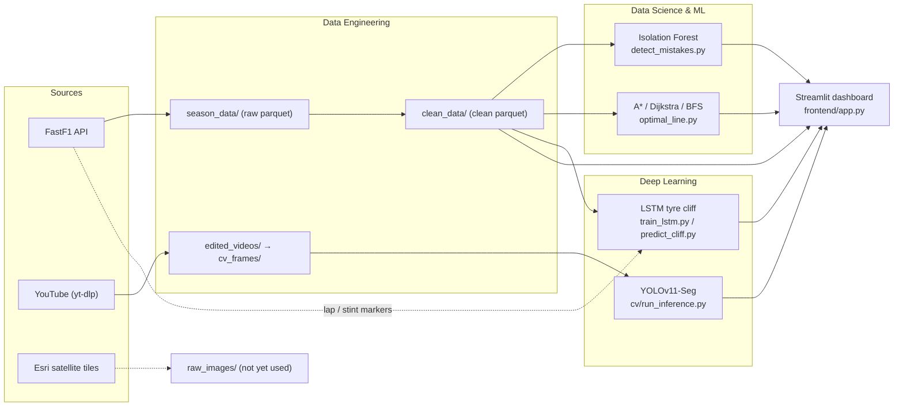

# ApexHunter 2.0 — Project Documentation

**Project Title:** ApexHunter 2.0 — F1 Telemetry & Onboard-Video Analytics Platform
**Courses:** Data Science & Machine Learning · Deep Learning
**Academic Year:** 2026–2027

| Sr. No. | Enrolment Number | Student Name |
|---|---|---|
| 1 | 23001091 | Parin Shah |
| 2 | 23000936 | Ayush Parikh |
| 3 | 23001119 | Malav Joshi |

> **Project history.** The first version of ApexHunter 2.0 was built in the previous semester
> (Jan–May 2026) for the *Artificial Intelligence* and *Big Data* courses. This semester the same
> codebase is being continued for *Data Science & Machine Learning* and *Deep Learning*. This
> document describes the project **as it currently exists in the code**. Section 8 lists every
> known limitation and is updated whenever the code changes.

---

## Table of Contents

1. [Overview](#1-overview)
2. [System Architecture](#2-system-architecture)
3. [Datasets](#3-datasets)
4. [Data Engineering Pipeline](#4-data-engineering-pipeline)
5. [Data Science & Machine Learning](#5-data-science--machine-learning)
6. [Deep Learning](#6-deep-learning)
7. [Dashboard](#7-dashboard)
8. [Current Status & Known Limitations](#8-current-status--known-limitations)
9. [Testing](#9-testing)
10. [How to Run](#10-how-to-run)

---

# 1. Overview

ApexHunter 2.0 analyses Formula 1 driving performance from two kinds of data:

- **Structured telemetry** for every driver in every qualifying and race session of the 2023 and
  2024 seasons (~57.9 million rows), fetched via the FastF1 library.
- **Unstructured onboard video** of the pole-position lap of every 2023 and 2024 Grand Prix
  (46 videos).

The telemetry and video feed four analytical components, and an interactive Streamlit dashboard
presents the results:

| Component | Technique | Course | Question it answers |
|---|---|---|---|
| Driver mistake detection | Isolation Forest (unsupervised anomaly detection) | DSML | Where in a session did the driver deviate from normal driving? |
| Racing-line search | A\*, Dijkstra, BFS on a telemetry-weighted grid | DSML (optimisation / search) | What is the lowest-cost path through the driver's own telemetry footprint? |
| Tyre cliff prediction | Stacked LSTM with Monte Carlo dropout | Deep Learning | When does pace drop off within a tyre stint? |
| Apex detection | YOLOv11-Seg instance segmentation (transfer learning) | Deep Learning | How close does the car come to the apex curb at each corner? |

**Planned this semester** (see [ROADMAP.md](ROADMAP.md)): each problem becomes a simple baseline →
machine learning → deep learning comparison. Mistake detection: Z-score vs the reworked Isolation
Forest vs an LSTM autoencoder. Tyre/pace prediction: Ridge regression vs a vanilla RNN vs the LSTM.
This document is updated as each part is built.

The project also includes supporting data infrastructure from the previous semester: a pandas ETL
pipeline, an equivalent Apache Spark job, HDFS storage, and a MongoDB document store.

---

# 2. System Architecture



### Repository layout

```text
backend/
  config.json                 seasons, frame-extraction, inference thresholds, circuits, video URLs
  scripts/
    utils.py                  shared paths, config loader, logger, IST timezone
    detect_mistakes.py        Isolation Forest orchestrator
    train_lstm.py             LSTM training orchestrator
    predict_cliff.py          LSTM prediction orchestrator
    optimal_line.py           racing-line orchestrator
    etl/                      download_season_data, clean_telemetry, fix_parquet_timestamps,
                              download_manual_videos, download_satellite_images
    bigdata/                  hdfs_manager, spark_clean_telemetry, mongo_manager
    cv/                       extract_frames, select_training_frames, extract_turns,
                              run_inference, inference_geometry/masking/hud/io
    isolation_forest/         mistakes_features, mistakes_model, mistakes_io
    lstm/                     tyre_data, tyre_model, tyre_io
    racing_line/              racing_line_grid, racing_line_search, racing_line_io
    tests/                    unit/ (25 files), integration/ (8 files), run_tests.py
frontend/
  app.py, config.py
  components/                 sidebar, data_loader, header_bar, telemetry_charts, track_map,
                              cv_feed, ai_analysis, racing_line, bigdata_tab, bigdata_charts
models/                       best.pt (YOLO), tyre_lstm.pt, tyre_scaler.pkl, tyre_config.json
data_lake/                    all data and model outputs (gitignored)
docs/                         this document and supporting reports
```

---

# 3. Datasets

## 3.1 Structured — FastF1 telemetry

| Property | Value |
|---|---|
| Source | Official F1 timing data via the `fastf1` Python library (v3.8) |
| Coverage | 2023 (22 rounds) and 2024 (24 rounds); Qualifying (Q) and Race (R) for each → 92 sessions |
| Rows | 57,874,119 |
| Size | 1,718 MB raw / 1,691 MB clean (snappy-compressed Parquet) |
| Granularity | One row per merged car-data/position sample; median interval ≈ 0.13 s (~7.7 Hz) |
| Typical size | ~420k rows per qualifying session, ~800k rows per race (20 drivers) |
| File naming | `{year}_{round}_{Q|R}.parquet`, e.g. `2023_1_Q.parquet` |

**Schema (clean data):**

| Column | Type | Meaning |
|---|---|---|
| `Date` | datetime | Absolute timestamp of the sample |
| `SessionTime` | timedelta | Time since session start, the main time axis |
| `Speed` | float32 | km/h |
| `RPM` | float32 | Engine revolutions per minute |
| `nGear` | int | Gear 0–8 |
| `Throttle` | float32 | Throttle pedal, 0–100 % |
| `Brake` | float32 | **Binary brake flag (0 = off, 1 = on).** FastF1 provides brake as a boolean, not a pressure. |
| `X`, `Y`, `Z` | float | Car position in FastF1 track coordinates |
| `Driver` | string | Car number as a string (e.g. `"1"` = Verstappen, `"44"` = Hamilton) |
| `Round`, `Session`, `Year` | int/str | Session identifiers |
| `Time` | timedelta | Synthesised by the cleaning step from the row index (see §8) |

## 3.2 Unstructured — onboard pole-lap video

| Property | Value |
|---|---|
| Source | YouTube, downloaded with `yt-dlp` (a few manually specified URLs in `config.json`) |
| Content | Onboard pole-position qualifying lap for each 2023 and 2024 round |
| Count / size | 46 videos; 2.3 GB downloaded, 1.8 GB after manual trimming to the lap |
| Format | MP4, ≤1080p |
| Extracted frames | 21,282 JPEGs at 5 fps (6.7 GB) |
| Annotated set | 506 frames selected (11 per video), labelled in Roboflow with two classes: `curb`, `road` |
| Exported dataset | 1,281 training images (after Roboflow augmentation) and 226 validation images |

## 3.3 Satellite imagery

24 circuit images (1280×1280 PNG, 76 MB) downloaded from Esri World Imagery with `staticmap`.
They are stored in `data_lake/raw_images/satellite_maps/` but the dashboard does not use them yet.

## 3.4 Data quality

| Issue | Observation | Handling |
|---|---|---|
| Missing values | Occasional NaN sensor packets | Rows with Speed, RPM, X and Y all missing are dropped; other gaps are forward-filled. In practice no rows were dropped (57,874,119 in = out). |
| Outliers | Throttle values up to 104 % appear in raw data | Clipping: Speed 0–380, RPM 0–15,000, Throttle 0–100, Brake 0–1 |
| Binary brake | `Brake` carries no pressure information | Treated as an on/off flag everywhere: a braking feature for the Isolation Forest, a fraction of braking samples per cell for the racing line, and fraction of the lap spent braking for the LSTM |
| GPS noise | X/Y jitter, especially at low speed | Not filtered |
| Imbalance | Races have ~2× the rows of qualifying sessions; DNFs truncate data | Models process each session independently |
| Selection bias | Onboard videos exist only for the pole sitter, which favours front-running teams | Acknowledged; CV results are per-lap case studies |

---

# 4. Data Engineering Pipeline

## 4.1 Extract — `etl/download_season_data.py`

For each configured season it reads the event schedule. For each round and each session type
(`Q`, `R`) it then loads the session with `fastf1` (`telemetry=True, laps=True, weather=False`) and
calls `laps.pick_drivers(d).get_telemetry()` for every driver. It keeps the 14 columns listed in §3.1
(without `Time`) and writes `data_lake/season_data/{year}_{round}_{type}.parquet`. Sessions whose
file already exists are skipped. API responses are cached in `cache/`.

## 4.2 Transform — `etl/clean_telemetry.py` (pandas)

| Step | Operation |
|---|---|
| 1 | Add any missing expected column (`Driver`→`"UNKNOWN"`, `Time`/`SessionTime`→index seconds, `nGear`→8, numerics→0) |
| 2 | Drop rows where Speed, RPM, X and Y are **all** NaN |
| 3 | Forward-fill all numeric columns |
| 4 | Clip Speed 0–380, RPM 0–15,000, Throttle 0–100, Brake 0–1 (binary flag) |
| 5 | Downcast Speed, RPM, Throttle, Brake, X, Y to `float32` |
| 6 | Write snappy Parquet to `data_lake/clean_data/` (skips files that already exist) |

## 4.3 Spark equivalent — `bigdata/spark_clean_telemetry.py`

The same transformation written in PySpark 3.5.1 (`local[*]`, 4 GB driver memory). It reads either
local `season_data/` or `hdfs://localhost:9000/apexhunter/season_data`. Forward-fill uses
`last(..., ignorenulls=True)` over a window partitioned by driver and ordered by `SessionTime`.
Output is Parquet partitioned by `Year/Round/Session`. The last recorded run (HDFS mode) processed
57,874,119 rows in 78 s and wrote 1,740 MB. A run log is written to `data_lake/spark_run_log.json`.
`etl/fix_parquet_timestamps.py` rewrites Parquet timestamps to microsecond precision so that Spark
can read them.

## 4.4 Storage — HDFS and MongoDB

- `bigdata/hdfs_manager.py` wraps `hadoop fs` commands to upload `season_data`, `clean_data` and
  `mistake_data` to `/apexhunter/...`, verify uploads, and write `data_lake/hdfs_status.json`.
- `bigdata/mongo_manager.py` (database `apexhunter` on `localhost:27017`) upserts:
  - `mistake_annotations`: one document per session × driver, containing the Isolation Forest
    metadata plus summary statistics (mean/std anomaly score, mistake rate, speeds).
  - `telemetry_sessions`: one metadata document per session file (92 documents).

  It also provides query helpers (leaderboard, per-driver history) and writes
  `data_lake/mongo_status.json`.

These systems are optional at runtime. The dashboard reads their JSON status files and falls back
gracefully when HDFS or MongoDB are offline.

---

# 5. Data Science & Machine Learning

## 5.1 Exploratory data analysis

EDA lives in the dashboard (Telemetry and Big Data tabs):

- Five-panel time series of Speed, Throttle, Brake, Gear and RPM with a time scrubber.
- Speed-coloured track map built from X/Y coordinates.
- Speed distribution histograms for the five drivers with the most samples.
- Pearson correlation heatmap of Speed, RPM, Throttle, Brake, X, Y, Z and nGear.
- Speed vs RPM scatter coloured by gear, which shows the gear-ratio bands.
- Brake/throttle overlap percentage per driver.

## 5.2 Driver mistake detection — Isolation Forest

**Files:** `detect_mistakes.py`, `isolation_forest/mistakes_features.py`, `mistakes_model.py`,
`mistakes_io.py`

### Idea
Isolation Forest is an unsupervised anomaly detector. It builds random trees that split on random
features at random thresholds. Points that are isolated after few splits (short average path length)
are anomalous. The model learns "normal driving" from the target driver together with a reference
driver, then flags the target driver's samples that are hard to explain as normal.

### Feature engineering (7 features, all float32)

| Feature | Formula | Captures |
|---|---|---|
| `speed_normalized` | Speed / 380 | Absolute pace |
| `throttle_intensity` | Throttle / 100 | Throttle application |
| `brake_intensity` | 1 if brake on, else 0 | Braking (FastF1 has no brake pressure, so this is the on/off flag) |
| `brake_throttle_overlap` | 1 if brake on and Throttle > 5 % | Simultaneous pedal use, a sign of lock-ups, instability or poor technique |
| `speed_delta` | ΔSpeed clipped to ±50 | Sudden acceleration/deceleration |
| `gear_change` | \|ΔnGear\| clipped to 0–4 | Gear skips |
| `rpm_normalized` | RPM / 15,000 | Engine load |

> **Note:** FastF1's `Brake` is binary, so `brake_intensity` is the on/off flag itself rather than
> a normalised pressure. Before October 2026 the code divided it by 100 and used a `> 5` threshold,
> which made both brake features carry no signal. That bug is fixed.

### Training procedure

1. Load the clean session; check that `Driver, Speed, RPM, Throttle, Brake, X, Y, SessionTime, nGear` exist.
2. Choose the **reference driver** = highest mean speed in the session (or in a separate `--reference` file).
3. Engineer features for the target and reference drivers and concatenate them as the training set.
4. **Contamination grid search with 5-fold CV:** contamination ∈ {0.005, 0.01, 0.015, 0.02, 0.03, 0.05};
   KFold(5, shuffle, seed 42); each fold is scored by the mean |decision_function| on the held-out fold.
   The highest-scoring value is selected (6 × 5 = 30 fits, 200 trees each).
5. Fit the final `IsolationForest(n_estimators=200, max_samples="auto", random_state=42)` on all training rows.
6. Score the **target driver only**: `anomaly_score = decision_function`, `is_mistake = predict == -1`.

### Outputs
- `data_lake/mistake_data/{session}_{driver}_mistakes.parquet` contains the original telemetry plus
  `anomaly_score`, `is_mistake` and the 7 features.
- `..._mistakes_meta.json` holds the session, driver, reference driver, best contamination, CV
  score per contamination value, total rows and mistakes, mistake rate, tree count, feature list and
  timestamp.

### Current results (2023 Bahrain GP race, driver #1)

| Metric | Value |
|---|---|
| Rows scored | 42,381 |
| Rows with brake on / brake + throttle overlap | 8,556 (20.2 %) / 65 |
| Flagged samples | 212 (0.50 %) |
| Flagged samples under braking / with pedal overlap | 201 / 5 |
| Selected contamination | 0.005 |
| Reference driver | #1 (Verstappen was also the fastest by mean speed, so the baseline is his own) |
| CV scores | 0.005 → 0.196, 0.01 → 0.171, 0.015 → 0.154, 0.02 → 0.145, 0.03 → 0.133, 0.05 → 0.116 |

The CV score falls steadily as contamination grows. Mean |decision_function| shrinks as the
threshold moves into the bulk of the data, so this criterion will always favour the smallest
value in the grid. It is not a real model-selection signal (see §8). Now that the brake features
carry information, 95 % of flagged samples are braking samples: the model treats braking itself as
unusual. This is a target for the planned Isolation Forest improvements.

### Usage
```bash
python backend/scripts/detect_mistakes.py --session data_lake/clean_data/2023_1_R.parquet --driver 1 [--reference <file>] [--output-dir <dir>] [--force]
```

## 5.3 Racing-line search — A\*, Dijkstra, BFS

**Files:** `optimal_line.py`, `racing_line/racing_line_grid.py`, `racing_line_search.py`, `racing_line_io.py`

This component uses classical search and optimisation rather than learning. It sits with DSML as
the optimisation part of the pipeline.

### Graph construction
- The driver's X/Y samples for the **whole session** are binned into square cells (default 50 track
  units). Each occupied cell becomes a node holding its mean speed, mean brake and sample count.
- Node cost = `max(0.01, 1 − mean_speed/380 + 2 · brake_fraction)`, where `brake_fraction` is the
  share of the cell's samples with the brake on (0–1). Faster cells are cheaper; cells where the
  driver is usually braking are more expensive.
- 8-connected grid. Edge cost = average of the two node costs × (1 for orthogonal, √2 for diagonal moves).
- A metres-per-unit scale is derived by comparing telemetry arc length per lap with the known
  circuit length (`--circuit-length`, default Bahrain 5.412 km).

### Search
- The driver's fastest lap is located with FastF1. The search is split into four legs between five
  waypoints taken at 0, ¼, ½, ¾ and the end of that lap, and the legs are concatenated.
- **A\***: heuristic = Euclidean grid distance × minimum node cost. This never overestimates, so A\*
  is optimal.
- **Dijkstra**: the same search with h = 0. It is the ground-truth check for A\*.
- **BFS**: ignores costs and finds the fewest hops. Its weighted cost is computed afterwards for comparison.

### Outputs
`data_lake/racing_lines/{session}_{driver}_racing_line.json` contains the driver's fastest-lap path
(every 10th sample), and for each algorithm: path, cost, nodes expanded, compute time, estimated time
saved and a found flag. It also holds per-segment deviation between the A\* path and the driver path.

### Current results — to be regenerated
The stored output for 2023 Bahrain qualifying (driver #1) is **not valid** and is not quoted here.
It was generated while the fastest-lap lookup was failing, so the search silently used the whole
session instead of the fastest lap (roadmap #19), and the metres-per-unit scale for qualifying
sessions is about 3× too large (roadmap #18: 0.303 instead of ≈0.10 m/unit). Results will be added
after both bugs are fixed and the output is regenerated. A\* and Dijkstra agreeing on cost
(optimality check) holds in the unit tests regardless.

### Usage
```bash
python backend/scripts/optimal_line.py --session data_lake/clean_data/2023_1_Q.parquet --driver 1 [--resolution 50] [--circuit-length 5.412] [--n-corners 16] [--force]
```

---

# 6. Deep Learning

## 6.1 Tyre cliff prediction — LSTM

**Files:** `train_lstm.py`, `predict_cliff.py`, `lstm/tyre_data.py`, `tyre_model.py`, `tyre_io.py`

### Problem
Tyre performance degrades over a stint and at some point drops sharply (the "cliff"). Knowing when
helps with pit-stop timing. The model is framed as a sequence-regression task: given the last 5
laps of a stint, predict the next lap's pace.

### Data preparation
1. Race sessions are processed in chronological order (by year, then round). For each one, FastF1 lap data (`LapStartTime`, `Time`, `Stint`, `Compound`, `TyreLife`,
   `LapNumber`, `LapTime`) is loaded and joined to the clean telemetry by session time.
2. Each lap is aggregated into 9 features: mean speed, mean throttle, mean brake (fraction of the
   lap spent braking), mean RPM, tyre age,
   one-hot compound (soft/medium/hard) and race lap number.
3. **Only representative laps are used.** Excluded: lap 1 (standing start), out-laps and in-laps
   (pit stops), laps run under safety car, VSC or red flag (FastF1 `TrackStatus` 4/5/6/7), deleted or
   FastF1-generated laps, laps with no lap time, and laps FastF1 marks as inaccurately timed.
   Yellow-flag laps are kept, because yellows are local and barely affect lap pace. On real races
   this removes about 13–16 % of laps; on the 2023 Bahrain and 2024 Miami races, 26–29 % of the
   windows built by the earlier, unfiltered pipeline contained at least one such lap.
4. Laps are grouped by stint. Stints with fewer than 3 usable laps are discarded.
5. Sliding windows of 5 laps → target = **mean speed of the following lap** (km/h). Windows are built
   only within runs of consecutive representative laps, so a window never bridges a removed lap
   (e.g. a safety-car period).
6. **Split by whole sessions, chronologically:** the most recent 10 % of race sessions form the
   test set, and the most recent 20 % of the remaining sessions form the validation set. Splitting
   by session rather than by sequence matters: neighbouring sliding windows share 4 of their 5 laps,
   so a per-sequence split would put near-identical samples on both sides.
7. `StandardScaler` (features) and z-normalisation (target) are fitted on the **training sessions
   only** and then applied to validation and test data, so no test statistics leak into training.

### Architecture

| Component | Value |
|---|---|
| Layers | 2 stacked `nn.LSTM` layers, `batch_first=True` |
| Hidden size | Selected by grid search from {32, 64, 128} |
| Dropout | 0.3 between LSTM layers |
| Head | Linear(hidden → 1) on the last time step |
| Loss / optimiser | MSE / Adam |
| Batch size | 32 |

### Hyperparameter search
6-configuration grid over hidden size and learning rate
(32/1e-3, 64/1e-3, 128/1e-3, 32/5e-4, 64/5e-4, 128/1e-4). Each configuration is trained for 20 epochs
and scored by best validation MSE. The final model is trained for 50 epochs with the winning
configuration. During every training run the weights from the best-validation epoch are kept and
restored at the end, so the saved model is the one that achieved the reported validation MSE.

### Inference and uncertainty
- **Monte Carlo dropout:** dropout stays active and 10 forward passes are averaged; mean ± 1 σ gives
  the confidence band.
- Predicted mean speed is converted to lap time with an estimated lap distance (mean speed × lap
  time over the stint's valid laps).
- The cliff lap is the first lap after the best predicted lap whose predicted time exceeds the best
  by more than 1.5 s. `laps_remaining` = stint length − cliff lap.
- Predictions are made for every representative lap of a stint. The first lap's prediction is
  seeded by padding with that lap's own features.
- Output: `data_lake/tyre_predictions/{session}_{driver}_tyre.json` with one entry per stint:
  `stint_index`, `n_laps`, `lap_numbers` (race lap number of each kept lap; numbers can skip removed
  laps), `actual_laps`, `predicted_laps`, `confidence_upper`, `confidence_lower`,
  `cliff_lap`, `laps_remaining`.

### Model compatibility
`tyre_config.json` records the feature names the model was trained on. Before loading,
`load_model_artifacts` checks them (and the input size) against the current code and raises a clear
"retrain with `train_lstm.py --force`" error on any mismatch.

### Results
**Retraining pending.** The saved model in `models/` is from April 2026, trained on an earlier
8-feature version and with the old (leaky) split. It reported val MSE 0.151 (normalised) and test
MAE 5.15 km/h; those numbers are not comparable with the corrected pipeline. `predict_cliff.py`
refuses to load it. The model will be retrained once the remaining LSTM-related changes are done.
The existing prediction file (2023 Bahrain race, #1) was produced by that old model and pipeline
(no lap filtering, no `lap_numbers`); it detected a cliff in stint 3 at lap 10 of 21. The dashboard
shows "Lap in stint" for such older files and real race lap numbers for new ones.

### Usage
```bash
python backend/scripts/train_lstm.py [--seasons 2023 2024] [--test-split 0.1] [--force]
python backend/scripts/predict_cliff.py --session data_lake/clean_data/2023_1_R.parquet --driver 1 [--force]
```

## 6.2 Apex detection — YOLOv11-Seg

**Files:** `cv/extract_frames.py`, `cv/select_training_frames.py`, `cv/run_inference.py`,
`cv/inference_geometry.py`, `cv/inference_masking.py`, `cv/inference_hud.py`, `cv/inference_io.py`,
`cv/extract_turns.py`

### Dataset construction
1. `extract_frames.py` extracts frames from each trimmed video at 5 fps in parallel (`ProcessPoolExecutor`), giving 21,282 frames.
2. `select_training_frames.py` takes 11 evenly spaced frames per video, giving 506 frames named `{year}_{video}_{frame}.jpg`.
3. The frames were annotated in Roboflow with polygon masks for **`curb`** (class 0) and **`road`** (class 1).
4. Roboflow augmentation (flips, crops, colour/brightness shifts, small rotations) produced the
   exported dataset of 1,281 training and 226 validation images (`data_lake/cv_dataset/data.yaml`).

### Model and training
YOLOv11-Seg was fine-tuned from COCO-pretrained weights on a Google Colab T4 GPU (transfer learning,
all layers trainable). The trained weights are `models/best.pt` (6 MB). The Colab training logs
(mAP50 / mAP50-95 for boxes and masks) are not stored in this repository (see §8).

### Turn windows from FastF1 (`extract_turns.py`)
The pipeline needs to know, for every moment of the video, whether the car is in a corner, which
way it turns, and how fast the corner is. These **turn windows** are built from FastF1 data:
1. **Corners** come from FastF1's official circuit information (`session.get_circuit_info().corners`:
   corner number and distance along the lap), so every corner is included. Bahrain has 15.
2. The **pole lap** is the pole sitter's fastest qualifying lap. Its telemetry gives the lap time at
   which each corner's distance is reached (the apex time). Each window spans 50 m of track before
   and after the apex; where neighbouring windows would overlap, the boundary is placed halfway
   between the apexes.
3. **Direction** is the sign of the GPS heading change over ±30 m around the apex.
4. **Speed class** comes from the minimum speed inside the window: Slow < 100 km/h ≤ Medium ≤
   200 km/h < Fast.
5. **Video offset (manual input):** onboard videos are trimmed by hand, so the timed lap starts a
   few seconds into the video (4.9 s for 2024 Bahrain). This one number per video is passed with
   `--video-offset` and added to every window.

Year, round and driver are read from the video path (`edited_videos/{year}/{round}_{venue}_{drv}_pole
- Trim.mp4`). The windows are saved as `processed_csv/{video}_turns.json` and used both by the
inference loop and by the dashboard's turn-by-turn report card.

Validated against windows hand-annotated from the 2024 Bahrain video: all 15 corners found; apex
times within 0.37 s on average (max 1.3 s, T12, a flat-out kink); window edges within about 0.6 s;
direction agrees for 14 of 15 corners. The exception is T5, a ~10° kink that telemetry reads as a
slight right. Automatic offset detection from the YOLO output is not possible because a curb is
detected in about 99 % of frames, straights included (curbs line the track everywhere). This was
also why corner windows are needed to separate apex curbs from straight-line curbs.

This replaced (a) windows typed in by hand for one Bahrain video, duplicated in the frontend, and
(b) an earlier `extract_turns.py` that detected corners from GPS curvature and merged nearby
corners (it found 11 of Bahrain's 15).

### Inference pipeline (`run_inference.py`)
For every video frame:
1. YOLO prediction (confidence 0.25) produces curb and road masks.
2. **Masking:** masks are resized to the frame and drawn into a colour overlay (curb red, road
   green). Curb contours on the wrong side of the screen for the expected turn direction are
   discarded (except in fast corners), and the largest remaining contour is kept.
3. **Geometry:** the contour's inner (track-side) edge is extracted. The minimum Euclidean distance
   is measured from a fixed front-wheel reference point (left wheel 18 % / right wheel 85 % of width,
   60 % of height; the side is chosen by turn direction).
4. **Temporal smoothing:** an exponential moving average (α = 0.15) is applied to the closest point
   and the distance.
5. **Classification** uses thresholds from `config.json` (hit 130 px, near 250 px), scaled ×0.75 in
   slow corners and ×1.35 in fast corners:
   `Hitting Apex` / `Near Apex` / `Wide Line` (fast corners) / `Missing Apex`. Frames outside a turn
   window are `Straight`. Frames inside a turn with no usable curb are `Tracking`. Distances above
   900 px are treated as "no apex curb".
6. **HUD rendering:** a blended mask overlay, wheel markers, a dotted tether to the curb, a pulsing
   target ring, a projected Bézier trajectory, a blurred info panel and a depth-scaled distance label.
7. The output video is re-encoded to H.264 with ffmpeg when it is available.

Outputs:
- `data_lake/processed_video/{video}_HUD.mp4`
- `data_lake/processed_csv/{video}_turns.json`: the turn windows used for this run.
- `data_lake/processed_csv/{video}_metrics.csv` with columns `frame_number, timestamp_sec,
  distance_cm, status, has_curb`. `distance_cm` is the pixel distance × 0.155, an approximate
  calibration.

### Current results (2024 Bahrain pole lap, Verstappen, 4,917 frames at 50 fps, offset 4.9 s)

| Status | Frames |
|---|---|
| Straight | 3,241 |
| Missing Apex | 497 |
| Tracking | 447 |
| Near Apex | 357 |
| Hitting Apex | 276 |
| Wide Line | 99 |

Turn-by-turn (closest approach per corner): 12 of 15 corners "Hitting Apex" (≤ 30 cm) and 3 "Near
Apex" (T5, T9, T15). The processed video is the 2024 one (confirmed by frame comparison); an older
code comment had labelled the hand-typed windows "Bahrain 2023".

### Usage
```bash
python backend/scripts/cv/extract_frames.py
python backend/scripts/cv/select_training_frames.py
python backend/scripts/cv/extract_turns.py --video "data_lake/edited_videos/2024/01_bahrain_ver_pole - Trim.mp4" --video-offset 4.9   # preview windows
python backend/scripts/cv/run_inference.py --input "data_lake/edited_videos/2024/01_bahrain_ver_pole - Trim.mp4" --video-offset 4.9 [--force]
```

---

# 7. Dashboard

`streamlit run frontend/app.py`. Data loads are cached with `@st.cache_data`.

| Area | Content |
|---|---|
| Sidebar | Year → Session → Driver selectors, plus green/grey status dots showing whether Isolation Forest, LSTM and racing-line outputs exist for the selection |
| Header | Track name, fastest lap (FastF1), top speed, driver number/name/team |
| 🏎 Race Intelligence | Master session-time scrubber; processed CV video with live apex-status badge, status counts and a turn-by-turn report card; track map in Speed or Mistakes mode with a lap selector |
| 📊 Telemetry | Speed/Throttle/Brake (on/off)/Gear/RPM subplots with a scrubber line; top speed and brake-overlap % (brake on and throttle > 5 %) |
| 🧠 AI Analysis | Isolation Forest track map with mistake markers per lap, plus anomalies, mistakes under braking and measured mistake rate for the selected lap; LSTM stint chart with predicted pace, confidence band and cliff marker |
| 🛣 Racing Line | Track outline with the driver's fastest lap and the selected algorithm's path; deviation per turn |
| 🗄️ Big Data | Pipeline DAG, HDFS and Spark statistics from the JSON logs, EDA charts for the selected session, LSTM and pathfinding summaries, live MongoDB leaderboard |

---

# 8. Current Status & Known Limitations

This section is kept up to date as fixes are made. Which issues will be fixed, and in what order,
is decided in [ROADMAP.md](ROADMAP.md).

### Working
- Telemetry download and cleaning for all 92 sessions; Spark, HDFS and MongoDB integration (last run May 2026).
- Isolation Forest, racing-line and CV inference pipelines run end to end.
- Dashboard with all five tabs.
- Unit test suite: 178 tests passing (230 including integration; the 4 failures are the known Isolation Forest issues #3/#10).

### Fixed
- **Oct 2026 – Binary brake handling.** `Brake` is now treated as an on/off flag across cleaning
  (pandas and Spark clip 0–1), Isolation Forest features, racing-line node cost and the dashboard.
  The Telemetry tab shows "Brake (on/off)" as a step line, brake overlap means brake on and
  throttle > 5 %, and the AI tab card is renamed "Under Braking". Outputs regenerated.
- **Oct 2026 – Scripts runnable by file path.** The 12 runnable scripts in `etl/`, `bigdata/` and
  `cv/` add `backend/scripts` to `sys.path`, so `python backend/scripts/etl/clean_telemetry.py`
  works as well as `python -m etl.clean_telemetry`. Covered by `test_script_entrypoints.py`.
- **Oct 2026 – Test runner interpreter.** `run_tests.py` launched tests with a bare `python`, which
  on Windows resolved to the system interpreter instead of the project venv. It now uses
  `sys.executable`.
- **Oct 2026 – LSTM training pipeline.** Sessions are now processed chronologically (round 10 used to
  sort before round 2); the test/validation splits hold out whole sessions; scalers are fitted on
  training data only; the best-validation-epoch weights are restored instead of keeping the last
  epoch; and incompatible saved models are rejected with a clear message. `train_lstm.py` exposes
  `run_training()`, which the LSTM integration test now runs end to end (it previously
  re-implemented the pipeline inline and crashed on a pre-refactor import).
- **Oct 2026 – LSTM lap filtering.** Lap 1, out/in-laps, SC/VSC/red-flag laps, deleted, generated,
  untimed and inaccurately-timed laps are excluded; training windows never bridge a removed lap;
  the prediction step no longer overwrites each stint's first lap with the second; and predictions
  record real race lap numbers, which the dashboard uses for its x-axis.
- **Oct 2026 – AI tab mistake rate.** The "Mistake Rate" card showed the contamination
  hyperparameter (e.g. 0.005) instead of the measured rate, and the caption repeated contamination
  where the rate belonged. The card now shows the selected lap's measured rate (matching the other
  per-lap cards) and the caption shows the session-wide rate alongside the contamination setting.
- **Oct 2026 – Single FastF1 cache and complete requirements.** FastF1 data was cached in three
  places: `cache/` (ETL, dashboard), `data_lake/cache/` (LSTM prediction) and FastF1's OS default
  folder outside the project (racing line, which never configured a cache). All backend code now
  calls `utils.enable_fastf1_cache()`, so everything uses `cache/`. `scipy` and `pillow`, which are
  imported directly, were added to `requirements.txt`. Unit tests guard both.
- **Oct 2026 – Deprecated Streamlit JavaScript injection removed.** The dashboard injected
  JavaScript through `st.components.v1.html` (deprecated) to stop users typing into dropdowns.
  All dropdowns now use Streamlit's native `selectbox(filter_mode=None)`, which blocks typing.
  Backspace/Delete would still clear a dropdown's shown value, so a small key-lock script blocks
  those two keys, injected with the supported `st.html(..., unsafe_allow_javascript=True)`.
- **Oct 2026 – CV turn windows from FastF1.** Hand-typed Bahrain windows (duplicated in the
  frontend with conflicting speed classes) and a curvature detector that found 11 of 15 corners
  were replaced by windows built from FastF1's official corner list and the pole lap's telemetry,
  plus a per-video offset. The dashboard report card reads the same saved windows.
- **Oct 2026 – Test-suite audit (step 1).** Weak, stale, circular and duplicate tests were fixed,
  merged or removed (249 → 230 tests, each checking real behaviour; details in `docs/TEST_AUDIT.md`).
  Bugs found on the way: training-frame selection never sampled the end of a video (now evenly
  spaced incl. first and last frame); racing-line start cells used a different grid origin from the
  grid; log lines with `→` were dropped on redirected Windows output (fixed for all scripts in
  `utils.setup_logger`); the racing line used FastF1's deprecated `pick_driver`.
- **Oct 2026 – Code cleanup.** Unused imports, variables, constants and two dead functions
  removed (`ruff check --select F` now passes).

### Known issues (to be fixed)

| # | Area | Issue |
|---|---|---|
| 2 | LSTM | The saved model predates the current 9-feature pipeline, so `predict_cliff.py` refuses to load it until it is retrained (deliberately deferred until other LSTM work is done). |
| 3 | Isolation Forest | The CV criterion always selects the smallest contamination. The reference driver can be the target driver. |
| 4 | CV | The CV panel is not linked to the selected session. YOLO training metrics are not in the repo. |
| 5 | Racing line | The "time saved" estimate saturates at the ±5 s clamp. "Per-corner" deviation uses equal segments. Turn labels in the frontend are Bahrain-specific. The grid is built from all of the driver's session laps. |
| 6 | Outputs | Model outputs exist for only one session/driver each (mistakes and tyre: 2023 R1 race #1; racing line: 2023 R1 qualifying #1; CV: Bahrain pole lap). |
| 8 | Spark | The numeric-column check compares type names without `()`, so the forward-fill step is skipped in PySpark 3.5. |
| 9 | Misc | `Time` is synthesised from the row index. Satellite images are unused. Team mapping is not season-specific. |
| 10 | Tests | 2 integration test files fail: `test_pipeline_schema` expects the old contamination grid and a removed meta key; `test_pipeline_correctness` catches only 1/11 injected anomalies (a symptom of #3). |
| 11 | Logging | The Isolation Forest grid-search log prints contamination with 2 decimals, so 0.005 shows as "0.01" (the Windows encoding crash on `→` is fixed). |
| 14 | Review (Oct 2026) | A full pre-commit review found further issues, logged as roadmap #18–#38. Most important: racing-line scale wrong for qualifying and silent full-session fallback (#18, #19); season downloader cannot download (string seasons, #25); YOLO masks vertically misaligned by up to ~23 px (#26); dashboard scrubbers out of sync, "Proj. End Pace" always red, brake-overlap % dominated by pit/garage samples (#31–#33). |

---

# 9. Testing

| Suite | Files | Tests | Notes |
|---|---|---|---|
| Unit | 25 | 178 | Feature engineering (exact values), Isolation Forest I/O, frame selection, CV geometry/classification/turn windows, racing-line grid/search/I/O (incl. cost-aware detours), LSTM data/filtering/training/model/I/O (incl. a learnability check), telemetry cleaning, dashboard (AI tab, dropdowns), project guards (script entry points, FastF1 cache, requirements, logging). All pass. Rewritten in Oct 2026 by the test-suite audit (see `docs/TEST_AUDIT.md`). |
| Integration | 8 | 52 | Full Isolation Forest pipeline (schema, outputs, correctness, edge cases, skip/force), racing-line pipeline, FastF1 turn windows vs the hand-annotated Bahrain 2024 lap, LSTM train → predict on synthetic data. Run only when `APEXHUNTER_RUN_SLOW=1`. 6 files pass; 2 have pre-existing failures (§8 #10). |

```bash
python backend/scripts/tests/run_tests.py          # unit tests
python backend/scripts/tests/run_tests.py --all    # unit + integration
```

---

# 10. How to Run

```bash
python -m venv .venv
.venv\Scripts\activate
pip install -r requirements.txt

# Data (already present in data_lake/ on the development machine)
python backend/scripts/etl/download_season_data.py
python backend/scripts/etl/clean_telemetry.py

# Models
python backend/scripts/detect_mistakes.py --session data_lake/clean_data/2023_1_R.parquet --driver 1
python backend/scripts/train_lstm.py --force
python backend/scripts/predict_cliff.py --session data_lake/clean_data/2023_1_R.parquet --driver 1
python backend/scripts/optimal_line.py --session data_lake/clean_data/2023_1_Q.parquet --driver 1

# Dashboard
streamlit run frontend/app.py
```

All timestamps written by the backend use IST (UTC+05:30).
